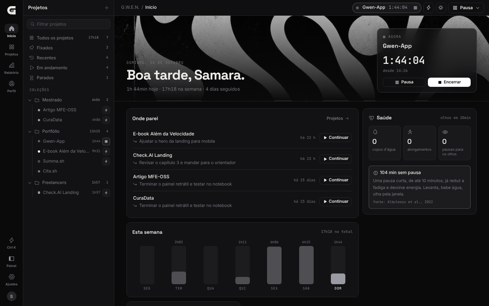
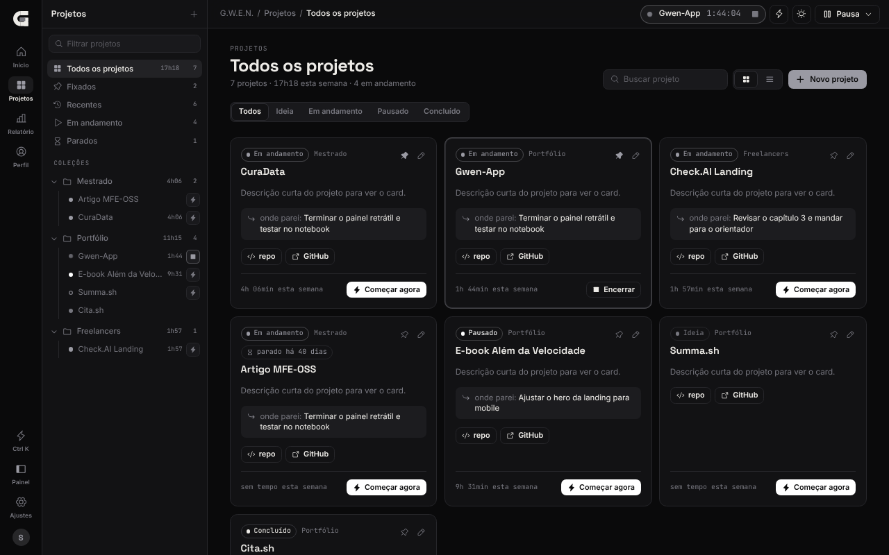
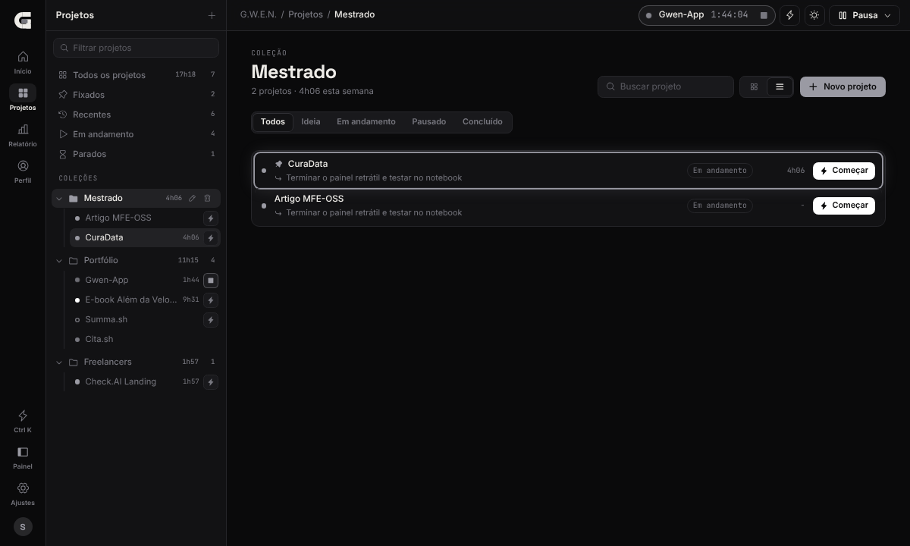
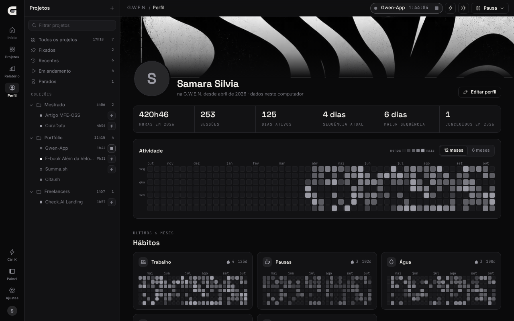
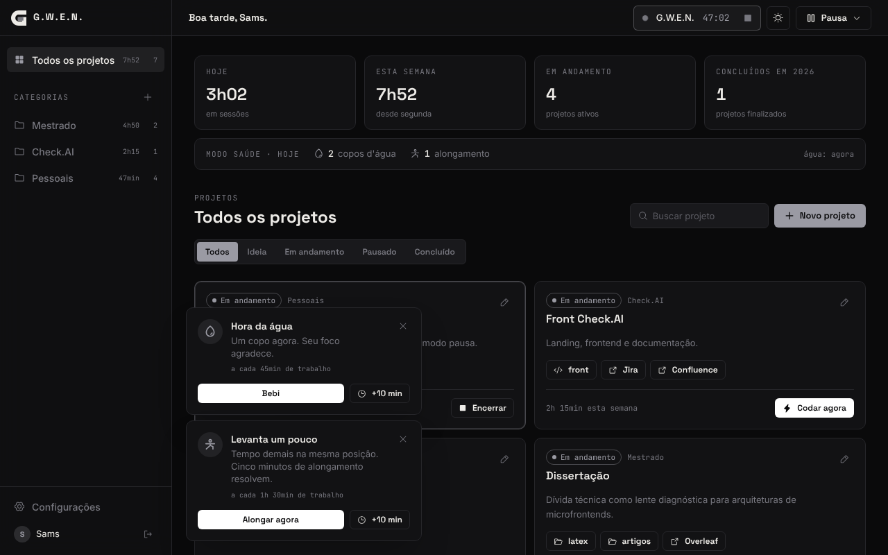
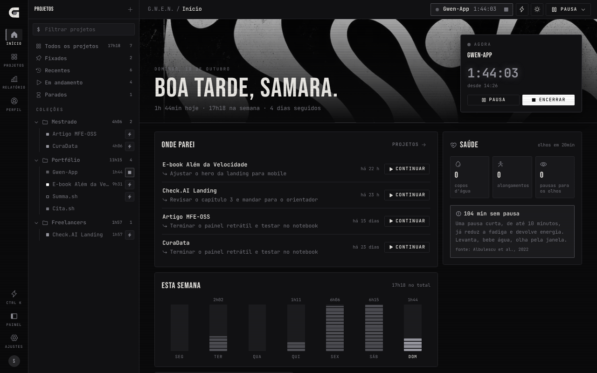
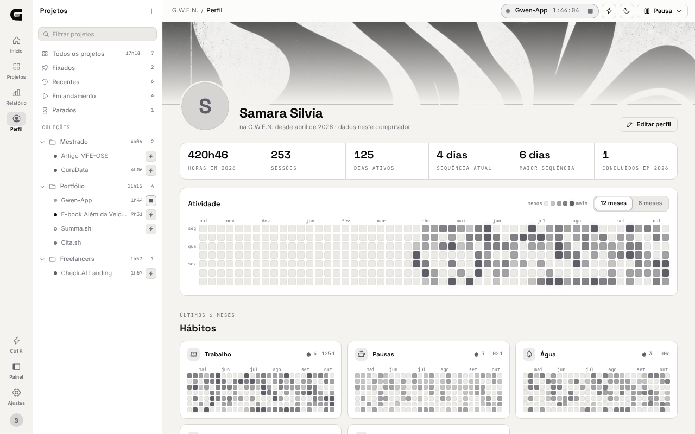

<picture>
  <source media="(prefers-color-scheme: light)" srcset="_assets/banners/banner-topo-claro.webp">
  
</picture>

<div align="center">

### Seu ambiente de trabalho em um clique. Sua pausa levada a sério.


[Sobre](#-sobre-o-projeto) · [Funcionalidades](#-funcionalidades) · [Como rodar](#-como-rodar) · [Como usar](#-como-usar) · [Temas](#-temas) · [Estrutura](#-estrutura) · [Documentação](#-documentação) · [Licença](#-licença)

</div>

---

### $ sobre o projeto

A **G.W.E.N.** (*Gestão de Wellness, Eficiência e Navegação*) é um assistente desktop para quem trabalha com muitos projetos ao mesmo tempo.

Todo dia o ritual é o mesmo: abrir a pasta certa, o documento, o repositório, as referências, o quadro de tarefas. Depois de horas, não dá para saber quanto tempo foi para cada projeto, e a pausa vira culpa. A G.W.E.N. junta essas três coisas num lugar só: **abre o ambiente de cada projeto com um clique**, **conta o tempo dedicado a cada um** e **trata a pausa como parte do trabalho**. Serve a quem programa, estuda, escreve ou desenha: um projeto é um conjunto de pastas e links.

A ideia já existia: abrir tudo de um projeto com um clique. Um post sobre hubs de desenvolvimento deu o empurrão para tirá-la do papel e levá-la além, com várias ferramentas no mesmo fluxo, não só vários editores. O que a diferencia é o descanso: a barra de pausa enche em vez de contar para trás.

> Projeto pessoal em uso diário. Cada versão nasce de uma necessidade real de quem usa.

<div align="center">
  
</div>

### $ funcionalidades

| Recurso | O que faz |
|---|---|
| **Seus dados, no seu computador** | Sem conta e sem internet. Tudo num banco local, com backup em JSON e cópia automática a cada versão. Você escolhe o nome e, se quiser, uma foto. |
| **Conta na nuvem** | Opcional e avançado: conecte o seu próprio Supabase e entre com Google ou e-mail para guardar os dados na nuvem em vez do computador. |
| **Início** | A capa do app: wallpaper, sessão atual com Pausa e Encerrar, onde você parou, barras da semana, projetos recentes e saúde do dia. |
| **Painel de projetos** | Árvore no jeito do Postman: coleções inteligentes (Fixados, Recentes, Em andamento, Parados) e as categorias como pastas, com o botão de começar em cada projeto. Abre e fecha com Ctrl + B. |
| **Categorias** | Agrupe por área (Mestrado, Freela, Pessoais...). Cada uma mostra o tempo da semana. |
| **Projetos** | Status, descrição, várias pastas e vários links por projeto. A descrição pode vir do README da pasta, e o link do repositório entra sozinho. Vista em grade ou em lista, e alfinete para fixar no topo. |
| **Começar agora** | Abre as pastas e links marcados, roda os comandos (ex.: `yarn dev`) e inicia a sessão de tempo. |
| **Pastas com ações** | A mesma pasta abre no VS Code, no Explorer e no Git Bash, juntos ou separados. |
| **Frentes** | Partes de um projeto (ex.: Landing e Plataforma). O Começar agora pergunta qual abrir, e o tempo é somado por frente. |
| **Status do Git** | Branch, alterações sem commit, commits sem push e data do último commit, direto no card. |
| **Onde parei** | Ao encerrar, a G.W.E.N. pergunta o próximo passo e mostra a nota no card e no próximo Começar agora. Projetos parados há 30 dias ganham um aviso. |
| **Bandeja e Ctrl + K** | Comece um projeto pelo ícone perto do relógio, sem abrir a janela, ou digitando o nome com Ctrl + K. Abre junto com o Windows, se quiser. |
| **Sessões de tempo** | Tempo por projeto, frente, categoria, dia e semana. Projetos concluídos no ano. |
| **Relatório** | Semana, mês, mês passado ou últimos 30 dias, por categoria, projeto e frente, com exportação em CSV. |
| **Modo pausa** | Café, refeição, leitura, respiro. A tela escurece e a barra de energia enche. |
| **Modo saúde** | Opcional: lembretes de água, alongamento e olhos que contam tempo de trabalho, com pausa de alongamento guiada. |
| **Alertas com fonte** | Semana acima de 44h ou de 55h, 90 minutos sem pausa, trabalho depois das 23h e 7 dias sem folga. Cada alerta mostra a pesquisa ou a norma em que se baseia. |
| **Perfil e hábitos** | Números do ano, sequência de dias, mapa de atividade e grades de hábitos (trabalho, pausas, água, alongamento, olhos). |
| **Bolha** | Minimizou, aparece uma bolha sempre no topo com o logo e o tempo da sessão. Arraste para mover, clique para voltar. |
| **Escala** | Ctrl + e Ctrl - aumentam e diminuem a interface (padrão 90%), Ctrl 0 volta ao padrão. |
| **Sessão esquecida** | Se o app fechar com uma sessão rodando, ele pergunta quanto tempo foi de verdade. |
| **Aparência** | Modo claro, escuro ou do sistema. Noir ou Personalizado por HEX/JSON. Estilo Moderno ou Terminal. |

<table>
<tr>
<td width="50%"></td>
<td width="50%"></td>
</tr>
<tr>
<td align="center"><sub>Projetos em grade, com o painel em árvore ao lado</sub></td>
<td align="center"><sub>Vista em lista, no jeito do Linear</sub></td>
</tr>
<tr>
<td width="50%"></td>
<td width="50%"></td>
</tr>
<tr>
<td align="center"><sub>Perfil: atividade do ano e hábitos</sub></td>
<td align="center"><sub>Modo pausa: a barra enche, não conta para trás</sub></td>
</tr>
</table>

### $ como rodar

#### 1. Pré-requisitos (Windows)

Confira no terminal:

```bash
node -v          # 20 ou mais
yarn -v
rustc --version
cargo --version
git --version    # para o status do Git nos cards
code --version   # opcional: a G.W.E.N. acha o VS Code instalado sozinha
```

| Se faltar | Como resolver |
|---|---|
| Node.js | Instale a versão LTS em [nodejs.org](https://nodejs.org) |
| Yarn | `npm install -g yarn` |
| Rust | Instale pelo [rustup.rs](https://rustup.rs) com as opções padrão |
| Build Tools | No instalador do Visual Studio Build Tools, marque **Desenvolvimento para desktop com C++** |
| Git | Instale pelo [git-scm.com](https://git-scm.com) (já traz o Git Bash) |
| Comando `code` | Só se o VS Code não estiver na pasta padrão: `Ctrl+Shift+P` > *Shell Command: Install 'code' command in PATH* |
| WebView2 | Já vem no Windows 10 e 11 |

#### 2. Dados

**Não precisa configurar nada.** Os dados ficam num banco SQLite (`gwen.db`) na pasta de dados do app, criado na primeira abertura. Sem `.env`, sem conta, sem internet.

<details>
<summary><b>Opcional: guardar os dados na sua própria nuvem (Supabase)</b></summary>

<br>

O modo local é o padrão e não precisa de nada. Quem preferir os dados na nuvem, em vez do computador, pode ligar o **modo conta** com um projeto Supabase próprio:

1. No SQL Editor do projeto, rode em ordem as migrações de [`supabase/migrations/`](supabase/migrations/) (001 a 006). Em **Project Settings > Data API**, adicione o schema `gwen` aos expostos ([`ADR-002`](docs/decisoes/ADR-002-schema-proprio-em-projeto-compartilhado.md)).
2. Em **Authentication > URL Configuration > Redirect URLs**, confira se estão `gwen://auth/callback` e, em desenvolvimento, `http://localhost:1420/`.
3. Se mais ninguém precisa criar conta nesse projeto, desligue **Allow new users to sign up** em Authentication. Assim só as contas que já existem conseguem entrar.
4. Na G.W.E.N., abra **Configurações > Conta na nuvem**, cole a URL e a chave anon (**Project Settings > API**) e use **Entrar na conta**, com Google ou e-mail.

A URL e a chave ficam só neste computador, e o instalador público não leva nenhuma. No modo conta, nenhum dado seu fica no computador e o app precisa de internet. **Sair da conta** volta ao modo local, e os dados na nuvem continuam intactos. O `.env` não é lido.

**Trazer dados das versões até a 0.3, que gravavam no Supabase:** com a conexão salva e ainda no modo local, use **Configurações > Dados > Importar da nuvem**. Ela entra na conta, copia tudo para o computador e sai. Nada é apagado, nem aqui nem na nuvem.

</details>

#### 3. Rodando em desenvolvimento

```bash
yarn          # instala as dependências
yarn app      # abre a G.W.E.N. como app desktop
```

A primeira execução compila o Rust e leva alguns minutos. As próximas são rápidas.

| Comando | O que faz |
|---|---|
| `yarn app` | Abre o **app desktop** em modo desenvolvimento, com recarga ao salvar |
| `yarn dev` | Só a interface, **no navegador** (`localhost:1420`). Pastas não abrem, só aparecem no console |
| `yarn app:build` | Gera o **instalador** do Windows |

> `yarn dev` é para trabalhar na interface: lá os dados ficam no armazenamento do navegador, separados do app. Para usar a G.W.E.N. de verdade (banco local, abrir VS Code e Git Bash), use `yarn app` ou instale.

#### 4. Instalando como aplicativo

```bash
yarn app:build
```

Ao terminar, o instalador fica em:

```text
src-tauri/target/release/bundle/nsis/GWEN_0.7.0_x64-setup.exe
```

Rode o `.exe` e instale (para atualizar, instale a versão nova por cima). A G.W.E.N. aparece no menu Iniciar como qualquer outro programa e pode ser fixada na barra de tarefas. Os dados ficam em `%APPDATA%\sh.devs-sam.gwen\` e não são tocados ao reinstalar, atualizar ou desinstalar.

> O Windows pode avisar que o app é de um "editor desconhecido", porque o instalador não tem assinatura digital. Clique em **Mais informações > Executar assim mesmo**.

#### 5. Publicando uma versão (com atualização automática)

Quem já instalou recebe a versão nova pelo próprio app, sem perder dados ([`ADR-009`](docs/decisoes/ADR-009-atualizacoes-sem-perder-dados.md)). Para isso, cada versão é assinada.

**Uma vez só, antes da primeira Release:**

```bash
yarn tauri signer generate -w ~/.tauri/gwen.key
```

> ⚠️ **Guarde o arquivo `gwen.key` e a senha num gerenciador de senhas, fora do repositório.** Se essa chave for perdida, quem já instalou não recebe mais atualizações automáticas e precisa reinstalar à mão. Não execute o comando de novo depois de publicar versões: uma chave nova invalida a anterior.

1. Copie a chave **pública** que o comando mostra (ou o conteúdo de `gwen.key.pub`) para `plugins.updater.pubkey` em `src-tauri/tauri.conf.json`.
2. No GitHub, em **Settings > Secrets and variables > Actions**, crie `TAURI_SIGNING_PRIVATE_KEY` (conteúdo do `gwen.key`) e `TAURI_SIGNING_PRIVATE_KEY_PASSWORD`. Não crie variáveis do Supabase: o instalador público não leva chaves, e quem quiser nuvem conecta a própria em Configurações.

**A cada versão:**

1. Atualize a versão em `package.json`, `src-tauri/tauri.conf.json` e `src-tauri/Cargo.toml`, o `CHANGELOG.md` e **este README** (badge da versão, funcionalidades, como usar, roadmap e prints).
2. Crie e envie a tag:
   ```bash
   git tag v0.7.0
   git push origin v0.7.0
   ```
3. O workflow [`release.yml`](.github/workflows/release.yml) gera o instalador e cria a Release como **rascunho**. Confira as notas e clique em **Publish**. A partir daí, as instalações existentes mostram "Atualizar e reiniciar".

### $ como usar

Na primeira abertura, diga como quer ser chamado e, se quiser, escolha uma foto. Dá para trocar depois em **Configurações > Perfil**.

**Navegação:** o trilho de ícones à esquerda leva às áreas (Início, Projetos, Relatório, Perfil e Ajustes). Ao lado fica o painel de projetos, que abre e fecha pelo ícone *Painel* ou com **Ctrl + B**. Em janela estreita, ele abre por cima do conteúdo.

1. **Crie categorias** no `+` do painel. Com uma categoria selecionada, aparecem os botões de renomear e excluir. Excluir não apaga os projetos: eles vão para "Sem categoria". A seta ao lado do nome abre e fecha a pasta.
2. **Cadastre um projeto** em *Novo projeto*. O ícone de pasta abre o seletor do Windows: o nome, a descrição (pelo README) e o link do repositório já vêm preenchidos. Marque com o que cada pasta abre (VS Code, Explorer, Git Bash), se ela entra no *Começar agora* e, se quiser, um comando para rodar (ex.: `yarn dev`). Fechar sem salvar guarda um rascunho, que aparece como card no painel.
3. **Frentes** (opcional): dê a mesma frente a pastas e links que andam juntos, como *Landing* e *Plataforma*. Itens sem frente valem para todas.
4. **Começar agora** abre tudo e inicia a sessão. Com frentes, ele pergunta qual abrir. O timer aparece na barra superior, no Início e no ícone da bandeja. Começar outro projeto encerra o atual. Projetos em *ideia* ou *pausado* passam para *em andamento*. Atalhos: **Ctrl + K** (digite o nome e Enter), o raio ao lado de cada projeto no painel ou clique direito no ícone da bandeja.
5. **Encerrar** pergunta onde você parou. A nota fica no card e no Início, com o botão *Continuar*.
6. **Fixar:** o alfinete no card leva o projeto para o topo da lista e para a coleção *Fixados*. Na tela de projetos, alterne entre grade e lista.
7. **Pausa** fica na barra superior e no Início. A barra enche até o tempo de recarga de cada tipo (café 10 min, refeição 45, leitura 25, respiro 5), mas chegar a 100% não encerra nada.
8. **Modo saúde** (Ajustes > Modo saúde): ligue e escolha os intervalos. O lembrete aparece no canto da tela e fica até você responder: fazer, adiar 10 minutos ou dispensar. *Alongar agora* abre uma pausa guiada de 5 minutos. Se a G.W.E.N. estiver em segundo plano, chega também uma notificação do Windows.
9. **Alertas de saúde** aparecem no cartão *Saúde* do Início, com a fonte de cada um. A lista completa de referências fica no fim do Perfil.
10. **Perfil:** números do ano, mapa de atividade de 12 ou 6 meses e as grades de hábitos. Passe o mouse num quadradinho para ver o dia.
11. **Relatório**, no trilho: escolha o período e veja para onde foi o tempo. *Exportar CSV* gera uma linha por sessão, que abre direto no Excel.
12. **Ajustes**: o painel lateral vira a lista de seções (Perfil, Aparência, Interface, Modo saúde, Dados, Conta na nuvem, Sistema, Sobre). Clique para ir direto a uma delas; *Voltar* leva à tela de antes. Em janela estreita, as seções aparecem como abas no topo.
13. **Interface** (Ajustes > Interface): escala da tela (também com **Ctrl +**, **Ctrl -** e **Ctrl 0**) e a bolha ao minimizar.
14. **Sistema** (Ajustes > Sistema): abrir junto com o Windows e fechar para a bandeja. Com a bandeja ligada, o X só esconde a janela; para sair de vez, clique direito no ícone e *Sair*.

<div align="center">
  
</div>

**Como o tempo é contado:** a sessão vai do *Começar agora* ao *Encerrar*, menos as pausas. Hoje e semana (a partir de segunda) contam só a parte que caiu no período. Com o app aberto, ele registra um sinal por minuto. Se abrir e encontrar uma sessão sem sinal há mais de 15 minutos, pergunta se encerra no último sinal, se você informa os minutos ou se continua (e o tempo com o app fechado entra como pausa).

> A V1 mede o tempo que você marcou, não o tempo real dentro de cada programa. A detecção de janela ativa está no roadmap.

### $ temas

A identidade da G.W.E.N. é **Noir**: preto, branco e cinzas, do logo ao wallpaper. Qualquer outra identidade é de quem usa, criada no tema **Personalizado** em **Configurações > Aparência**. Modo, cor e estilo são escolhas independentes.

**Modo:** escuro, claro ou o do sistema (acompanha o Windows). O botão de sol e lua na barra superior alterna rápido entre claro e escuro.

| Cores | | Estilo | |
|---|---|---|---|
| **Noir** | identidade do sistema | **Moderno** | cantos arredondados, vidro na navegação e na pausa |
| **Personalizado** | 9 tokens por HEX, com nome e paleta clara opcional | **Terminal** | no jeito do Atelier.sh: Bebas Neue nos títulos, mono no resto, rótulos em caixa alta, filtros com borda e scanlines |

<table>
<tr>
<td width="50%"></td>
<td width="50%"></td>
</tr>
<tr>
<td align="center"><sub>Noir + Terminal</sub></td>
<td align="center"><sub>Personalizado com uma identidade de usuário</sub></td>
</tr>
<tr>
<td width="50%"></td>
<td width="50%"></td>
</tr>
<tr>
<td align="center"><sub>Perfil no Noir claro</sub></td>
<td align="center"><sub>Modo pausa no claro</sub></td>
</tr>
</table>

**Compartilhando temas:** o Personalizado tem *copiar JSON* e *colar JSON*. O formato é este (as chaves `onPhosphor` e `onEmber` são opcionais e forçam a cor do texto sobre os acentos; sem elas, o app escolhe pelo maior contraste):

```json
{
  "gwenTheme": 1,
  "name": "Meu tema",
  "void": "#0B0B0B",
  "surface": "#141413",
  "surfaceAlt": "#1A1A18",
  "phosphor": "#972fff",
  "ember": "#ff22d6",
  "bone": "#E8E4DE",
  "muted": "#6B6B63",
  "rule": "#252523",
  "ruleLight": "#2E2E2A",
  "onPhosphor": "#FFFFFF",
  "onEmber": "#FFFFFF"
}
```

No Personalizado, o logo usa o acento principal no corpo e o secundário na carga. No Noir, é branco com a carga em cinza. O painel da primeira abertura mantém o wallpaper e o logo Noir em qualquer tema, porque é a cara do sistema.

Os derivados dos tokens (`--c-phosphor-12`, `--c-void-veil`...) usam `color-mix`, então acompanham qualquer tema sem configuração extra. Os mapas de calor usam o acento principal: no Noir ficam em cinzas, no Personalizado ganham a sua cor.

### $ estrutura

```text
gwen/
├── src/
│   ├── components/      trilho, painel de projetos, topbar, cards, mapa de calor, formulário, pausa, Ctrl + K, onde parei, logo
│   ├── context/         perfil, workspace (dados e sessões), saúde, toasts
│   ├── data/            repository, store (SQLite ou nuvem), backup e importação
│   ├── lib/             temas, tempo, escala, coleções, hábitos, alertas de saúde, bolha, relatório, Git, bandeja, ponte com o Rust
│   ├── pages/           início, projetos, perfil, relatório, configurações, primeira abertura, bolha
│   └── styles/          tokens e estilos Moderno/Terminal
├── src-tauri/
│   ├── src/lib.rs       comandos nativos: VS Code, Explorer, Git Bash, comandos, Git, README, bandeja; migrações
│   ├── migrations/      esquema do SQLite local
│   ├── app-icon.svg     fonte do ícone (yarn tauri icon src-tauri/app-icon.svg)
│   └── tauri.conf.json  janelas (principal e bolha), atualização e instalador
├── docs/                arquitetura, modelo de dados e decisões (ADR)
├── supabase/            migrações SQL com RLS, para a nuvem opcional
├── _assets/             banners, prints e gerador dos banners (com o wallpaper)
├── CHANGELOG.md
├── LICENSE              proprietária, todos os direitos reservados
├── NOTICE.md            autoria e resumo da licença
└── README.md
```

As decisões de arquitetura estão registradas em [`docs/`](docs/), uma por arquivo.

### $ limitações

- Caminhos de pasta são por máquina. Em outro computador, a pasta pode não existir (o app avisa).
- O instalador não tem assinatura digital, então o Windows avisa na primeira instalação.
- Uma sessão por vez.
- O status do Git precisa do Git instalado e só aparece em pastas que são repositórios.
- A bandeja, os comandos, a bolha e o abrir com o Windows foram feitos e testados para Windows.
- Os alertas de saúde são lembretes com base em referências publicadas, não diagnóstico.
- No modo local, os dados de um computador não aparecem no outro (dá para levar com o backup em JSON).
- O modo conta guarda tudo na nuvem, então exige internet, e cada leitura baixa a tabela inteira. Com históricos muito grandes, fica mais lento.

### $ roadmap

- [x] **V0.1** · launcher, categorias, sessões, modo pausa, temas
- [x] **V0.2** · login com Google, modo claro e escuro
- [x] **V0.3** · modo saúde: água, alongamento, olhos
- [x] **V0.4** · dados locais (SQLite), foto do perfil, conta na nuvem opcional, backup e importação
- [x] **V0.5** · status do Git, frentes, várias ações por pasta, link do repositório automático, rascunho, abrir com o Windows, abertura animada
- [x] **V0.6** · bandeja, Ctrl + K, onde parei, projetos parados, descrição pelo README, comandos por pasta, relatório com CSV
- [x] **V0.7** · nova navegação (trilho e painel em árvore), Início, Perfil com hábitos, alertas de saúde com fonte, escala da interface, bolha ao minimizar, estilo Terminal no jeito do Atelier.sh
- [ ] **V0.8** · lançador universal (Windows Terminal, Discord, WhatsApp e outros apps), mapeamento de janelas e jogos, com alertas de tempo
- [ ] **V0.9** · tarefas por projeto em lista e kanban, com Issues do GitHub
- [ ] **V0.10** · calendário, com Google Calendar
- [ ] **V0.11** · finanças: modelo do projeto, receitas e valor real por hora
- [ ] **V0.12** · caderno: playbook de padrões, modelos (README, ADR) e editor que salva no repositório
- [ ] **V0.13** · ideias: captura, descrição e "virar projeto"
- [ ] **V0.14** · padrões de trabalho: ritmo, foco e histórico do Git
- [ ] **V1.0** · assistente local que conversa sobre os seus dados e revisa contra o seu playbook

### $ documentação

| Código | Título |
|---|---|
| [`ARQ-001`](docs/ARQ-001-visao-geral.md) | Visão geral da arquitetura: camadas, fluxo do Começar agora, ciclo do tempo |
| [`DAT-001`](docs/DAT-001-modelo-de-dados.md) | Modelo de dados: tabelas, invariantes, regras de tempo |
| [`ADR-001`](docs/decisoes/ADR-001-tauri-em-vez-de-electron.md) | Tauri em vez de Electron |
| [`ADR-002`](docs/decisoes/ADR-002-schema-proprio-em-projeto-compartilhado.md) | Schema próprio num projeto Supabase compartilhado |
| [`ADR-003`](docs/decisoes/ADR-003-tempo-por-sessao-manual-na-v1.md) | Tempo por sessão manual na V1 |
| [`ADR-004`](docs/decisoes/ADR-004-identidade-noir-e-temas-por-tokens.md) | Identidade Noir e temas por tokens |
| [`ADR-005`](docs/decisoes/ADR-005-context-api-na-v1.md) | Context API na V1 |
| [`ADR-006`](docs/decisoes/ADR-006-login-google-por-deep-link.md) | Login com Google por deep link |
| [`ADR-007`](docs/decisoes/ADR-007-modo-claro-como-terceiro-eixo.md) | Modo claro como terceiro eixo da aparência |
| [`ADR-008`](docs/decisoes/ADR-008-lembretes-por-tempo-de-trabalho.md) | Lembretes de saúde por tempo de trabalho |
| [`ADR-009`](docs/decisoes/ADR-009-atualizacoes-sem-perder-dados.md) | Atualizações sem perder dados |
| [`ADR-010`](docs/decisoes/ADR-010-dados-locais-primeiro.md) | Dados locais primeiro |
| [`ADR-011`](docs/decisoes/ADR-011-shell-em-trilho-e-saude-com-fonte.md) | Shell em trilho e saúde com fonte |
| [`ADR-012`](docs/decisoes/ADR-012-codigo-proprietario.md) | Código proprietário |

O histórico de versões está no [`CHANGELOG.md`](CHANGELOG.md).

### $ licença

A G.W.E.N. é **software proprietário**. Copyright (c) 2026 Samara Silvia Sabino. Todos os direitos reservados. Os termos estão em [`LICENSE`](LICENSE) e o resumo em [`NOTICE.md`](NOTICE.md).

- **Pode:** ler o código aqui no GitHub e instalar o instalador oficial (Releases ou site), para uso pessoal.
- **Não pode sem autorização:** copiar o código, modificar, criar versões derivadas, redistribuir (inclusive o instalador), vender ou usar o nome, o logo e a identidade visual.

Qualquer outro uso precisa ser combinado antes com a autora ([@devs_sam](https://instagram.com/devs_sam)).

<div align="center">

*Uma sessão de cada vez. Uma pausa de cada vez.*

Feito por [Samara Silvia](https://github.com/SamaraSilvia81) · [@devs_sam](https://instagram.com/devs_sam)

</div>

<picture>
  <source media="(prefers-color-scheme: light)" srcset="_assets/banners/banner-rodape-claro.webp">
  
</picture>