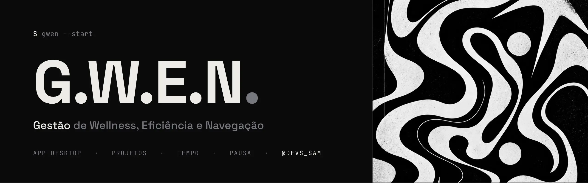
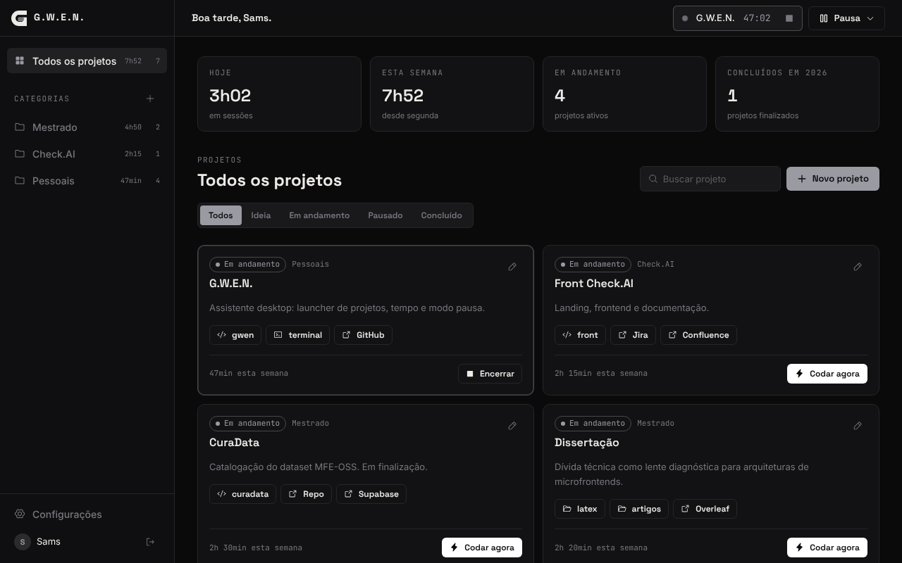
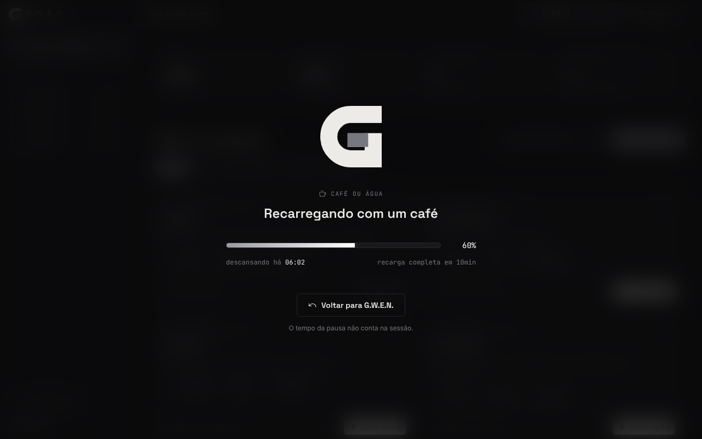
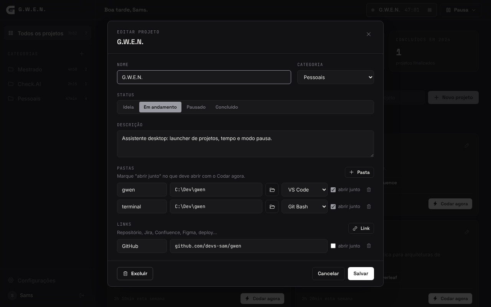
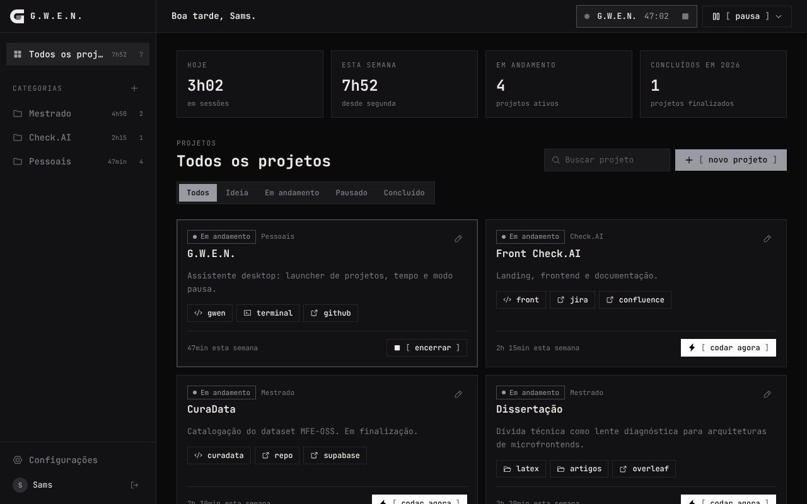
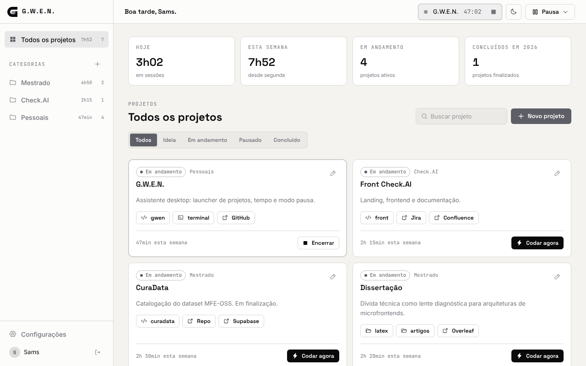
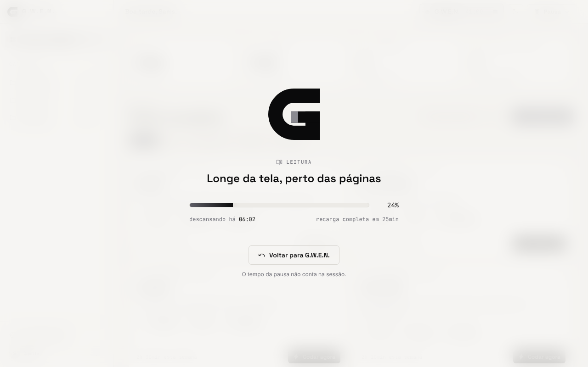
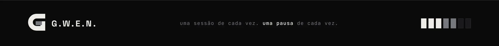

<picture>
  <source media="(prefers-color-scheme: light)" srcset="_assets/banners/banner-topo-claro.webp">
  
</picture>

<div align="center">

### Seu ambiente de trabalho em um clique. Sua pausa levada a sério.


[Sobre](#-sobre-o-projeto) · [Funcionalidades](#-funcionalidades) · [Como rodar](#-como-rodar) · [Como usar](#-como-usar) · [Temas](#-temas) · [Estrutura](#-estrutura) · [Documentação](#-documentação) · [Licença](#-licença)

</div>

---

### $ sobre o projeto

A **G.W.E.N.** (*Gestão de Wellness, Eficiência e Navegação*) é um assistente desktop para quem trabalha com muitos projetos ao mesmo tempo.

Todo dia o ritual é o mesmo: abrir o VS Code na pasta certa, o terminal no diretório certo, o Jira, o Confluence, o repositório. Depois de horas, não dá para saber quanto tempo foi para cada projeto, e a pausa vira culpa. A G.W.E.N. junta essas três coisas num lugar só: **abre o ambiente de cada projeto com um clique**, **conta o tempo dedicado a cada um** e **trata a pausa como parte do trabalho**.

A ideia nasceu de um post sobre hubs de desenvolvimento e foi adaptada para um fluxo com várias ferramentas, não vários editores. O cuidado com o descanso é o que diferencia: a barra de pausa enche em vez de contar para trás.

> Projeto pessoal em uso diário. Cada versão nasce de uma necessidade real de quem usa.

<div align="center">
  
</div>

### $ funcionalidades

| Recurso | O que faz |
|---|---|
| **Login** | Google ou e-mail e senha. Projetos, tempos e aparência ficam na nuvem. |
| **Categorias** | Agrupe por área (Mestrado, Freela, Pessoais...). Cada uma mostra o tempo da semana. |
| **Projetos** | Status, descrição, várias pastas e vários links por projeto. |
| **Codar agora** | Abre as pastas e links marcados como "abrir junto" e inicia a sessão de tempo. |
| **Pastas com ação** | Cada pasta abre no VS Code, no Explorer ou no Git Bash. |
| **Sessões de tempo** | Tempo por projeto, categoria, dia e semana. Projetos concluídos no ano. |
| **Modo pausa** | Café, refeição, leitura, respiro. A tela escurece e a barra de energia enche. |
| **Sessão esquecida** | Se o app fechar com uma sessão rodando, ele pergunta quanto tempo foi de verdade. |
| **Aparência** | Modo claro, escuro ou do sistema. Noir ou Personalizado por HEX/JSON. Estilo Moderno ou Terminal. |

<table>
<tr>
<td width="50%"></td>
<td width="50%"></td>
</tr>
<tr>
<td align="center"><sub>Modo pausa: a barra enche, não conta para trás</sub></td>
<td align="center"><sub>Cada pasta com a sua ação</sub></td>
</tr>
</table>

### $ como rodar

#### 1. Pré-requisitos (Windows)

Confira no terminal:

```bash
node -v          # 20 ou mais
yarn -v
rustc --version
cargo --version
code --version   # necessário para o Codar agora abrir o VS Code
```

| Se faltar | Como resolver |
|---|---|
| Node.js | Instale a versão LTS em [nodejs.org](https://nodejs.org) |
| Yarn | `npm install -g yarn` |
| Rust | Instale pelo [rustup.rs](https://rustup.rs) com as opções padrão |
| Build Tools | No instalador do Visual Studio Build Tools, marque **Desenvolvimento para desktop com C++** |
| Comando `code` | No VS Code: `Ctrl+Shift+P` > *Shell Command: Install 'code' command in PATH* |
| WebView2 | Já vem no Windows 10 e 11 |

#### 2. Banco de dados (Supabase)

As tabelas ficam num schema próprio, o `gwen`. Então dá para usar **um projeto Supabase que você já tem** para outro app, sem criar um novo e sem conflito de nomes.

1. Abra o projeto no [supabase.com](https://supabase.com) (um existente ou um novo).
2. Em **SQL Editor > New query**, rode os arquivos de [`supabase/migrations/`](supabase/migrations/) **em ordem** (`001`, depois `002`). Cole, clique em **Run**, repita. Eles podem ser rodados de novo sem estragar nada.
3. Em **Project Settings > Data API > Exposed schemas**, adicione `gwen` e salve. Sem isso a API responde que o schema não existe.
4. Copie `.env.example` para `.env` e preencha com os dados de **Project Settings > API**:

   ```env
   VITE_SUPABASE_URL=https://xxxx.supabase.co
   VITE_SUPABASE_ANON_KEY=eyJhbGciOi...
   VITE_SUPABASE_SCHEMA=gwen
   ```

5. **Login com Google:** em **Authentication > URL Configuration > Redirect URLs**, adicione:

   ```text
   gwen://auth/callback
   http://localhost:1420/
   ```

   O provedor Google precisa estar ativo em **Authentication > Sign In / Providers > Google**. Se o projeto já é usado por outro app com Google (como o Sparky), isso já está feito.

6. *Opcional:* em **Authentication > Sign In / Providers > Email**, desligue **Confirm email** para a conta entrar direto depois do cadastro. Se o projeto for compartilhado, isso vale para os outros apps dele também.

> O login (`auth.users`) é do projeto inteiro: a mesma conta funciona em todos os apps que usam aquele projeto. Os dados da G.W.E.N. ficam isolados no schema `gwen`, com RLS.

#### 3. Rodando em desenvolvimento

```bash
yarn          # instala as dependências
yarn app      # abre a G.W.E.N. como app desktop
```

A primeira execução compila o Rust e leva alguns minutos. As próximas são rápidas.

| Comando | O que faz |
|---|---|
| `yarn app` | Abre o **app desktop** em modo desenvolvimento, com recarga ao salvar |
| `yarn dev` | Só a interface, **no navegador** (`localhost:1420`). Pastas não abrem, só aparecem no console |
| `yarn app:build` | Gera o **instalador** do Windows |

> `yarn dev` é para trabalhar na interface. Para usar a G.W.E.N. de verdade (abrir VS Code, Git Bash, login com Google voltando para o app), use `yarn app` ou instale.

#### 4. Instalando como aplicativo

```bash
yarn app:build
```

Ao terminar, o instalador fica em:

```text
src-tauri/target/release/bundle/nsis/GWEN_0.2.0_x64-setup.exe
```

Rode o `.exe` e instale. A G.W.E.N. aparece no menu Iniciar como qualquer outro programa e pode ser fixada na barra de tarefas. O instalador também registra o endereço `gwen://`, usado pelo login com Google. Para atualizar, gere o instalador da versão nova e instale por cima.

> O Windows pode avisar que o app é de um "editor desconhecido", porque o instalador não tem assinatura digital. Clique em **Mais informações > Executar assim mesmo**.

### $ como usar

1. **Crie categorias** no `+` da lateral. Com uma categoria selecionada, aparecem os botões de renomear e excluir. Excluir não apaga os projetos: eles vão para "Sem categoria".
2. **Cadastre um projeto** em *Novo projeto*. O ícone de pasta abre o seletor do Windows. Escolha a ação de cada pasta e marque **abrir junto** no que deve abrir com o *Codar agora*. A mesma pasta pode entrar duas vezes, uma no VS Code e outra no Git Bash.
3. **Codar agora** abre tudo e inicia a sessão. O timer aparece na barra superior. Começar outro projeto encerra o atual. Projetos em *ideia* ou *pausado* passam para *em andamento*.
4. **Pausa** fica na barra superior. A barra enche até o tempo de recarga de cada tipo (café 10 min, refeição 45, leitura 25, respiro 5), mas chegar a 100% não encerra nada.

**Como o tempo é contado:** a sessão vai do *Codar agora* ao *Encerrar*, menos as pausas. Hoje e semana (a partir de segunda) contam só a parte que caiu no período. Com o app aberto, ele registra um sinal por minuto. Se abrir e encontrar uma sessão sem sinal há mais de 15 minutos, pergunta se encerra no último sinal, se você informa os minutos ou se continua (e o tempo com o app fechado entra como pausa).

> A V1 mede o tempo que você marcou, não o tempo real dentro de cada programa. A detecção de janela ativa está no roadmap.

### $ temas

A identidade da G.W.E.N. é **Noir**: preto, branco e cinzas, do logo ao wallpaper. Qualquer outra identidade é de quem usa, criada no tema **Personalizado** em **Configurações > Aparência**. Modo, cor e estilo são escolhas independentes.

**Modo:** escuro, claro ou o do sistema (acompanha o Windows). O botão de sol e lua na barra superior alterna rápido entre claro e escuro.

| Cores | | Estilo | |
|---|---|---|---|
| **Noir** | identidade do sistema | **Moderno** | cantos arredondados, vidro na navegação e na pausa |
| **Personalizado** | 9 tokens por HEX, com nome e paleta clara opcional | **Terminal** | tudo em mono, cantos retos, botões `[ assim ]` |

<table>
<tr>
<td width="50%"></td>
<td width="50%"></td>
</tr>
<tr>
<td align="center"><sub>Noir + Terminal</sub></td>
<td align="center"><sub>Personalizado com uma identidade de usuário</sub></td>
</tr>
<tr>
<td width="50%"></td>
<td width="50%"></td>
</tr>
<tr>
<td align="center"><sub>Noir no modo claro</sub></td>
<td align="center"><sub>Modo pausa no claro</sub></td>
</tr>
</table>

**Compartilhando temas:** o Personalizado tem *copiar JSON* e *colar JSON*. O formato é este (as chaves `onPhosphor` e `onEmber` são opcionais e forçam a cor do texto sobre os acentos; sem elas, o app escolhe pelo maior contraste):

```json
{
  "gwenTheme": 1,
  "name": "Meu tema",
  "void": "#0B0B0B",
  "surface": "#141413",
  "surfaceAlt": "#1A1A18",
  "phosphor": "#972fff",
  "ember": "#ff22d6",
  "bone": "#E8E4DE",
  "muted": "#6B6B63",
  "rule": "#252523",
  "ruleLight": "#2E2E2A",
  "onPhosphor": "#FFFFFF",
  "onEmber": "#FFFFFF"
}
```

No Personalizado, o logo usa o acento principal no corpo e o secundário na carga. No Noir, é branco com a carga em cinza. O painel do login mantém o wallpaper e o logo Noir em qualquer tema, porque é a cara do sistema.

Os derivados dos tokens (`--c-phosphor-12`, `--c-void-veil`...) usam `color-mix`, então acompanham qualquer tema sem configuração extra.

### $ estrutura

```text
gwen/
├── src/
│   ├── components/      sidebar, topbar, cards, formulário, pausa, logo
│   ├── context/         auth, workspace (dados e sessões), toasts
│   ├── data/            repository.js: toda conversa com o Supabase
│   ├── lib/             temas, tempo, estatísticas, ponte com o Rust
│   ├── pages/           login, dashboard, configurações
│   └── styles/          tokens e estilos Moderno/Terminal
├── src-tauri/
│   ├── src/lib.rs       comandos nativos: abrir VS Code, Explorer, Git Bash
│   ├── app-icon.svg     fonte do ícone (yarn tauri icon src-tauri/app-icon.svg)
│   └── tauri.conf.json
├── docs/                arquitetura, modelo de dados e decisões (ADR)
├── supabase/            migração SQL com RLS
├── _assets/             banners, prints e gerador dos banners (com o wallpaper)
├── CHANGELOG.md
├── LICENSE              proprietária, todos os direitos reservados
├── NOTICE.md            autoria e termos adicionais
└── README.md
```

As decisões de arquitetura estão registradas em [`docs/`](docs/), uma por arquivo.

### $ limitações

- Caminhos de pasta são por máquina. Em outro computador, a pasta pode não existir (o app avisa).
- O instalador não tem assinatura digital, então o Windows avisa na primeira instalação.
- Uma sessão por vez.
- Precisa de internet para salvar e carregar dados.

### $ roadmap

- [x] **V0.1** · launcher, categorias, sessões, modo pausa, temas
- [x] **V0.2** · login com Google, modo claro e escuro
- [ ] **V0.3** · detecção automática da janela ativa (tempo real em cada programa)
- [ ] **V0.4** · widget flutuante "sempre no topo" com timer e energia
- [ ] **V0.5** · modo saúde opcional: água, alongamento, check-in de humor, alerta de excesso
- [ ] Histórico por mês e ano · dias sem uso como descanso · modo offline

### $ documentação

| Código | Título |
|---|---|
| [`ARQ-001`](docs/ARQ-001-visao-geral.md) | Visão geral da arquitetura: camadas, fluxo do Codar agora, ciclo do tempo |
| [`DAT-001`](docs/DAT-001-modelo-de-dados.md) | Modelo de dados: tabelas, invariantes, regras de tempo |
| [`ADR-001`](docs/decisoes/ADR-001-tauri-em-vez-de-electron.md) | Tauri em vez de Electron |
| [`ADR-002`](docs/decisoes/ADR-002-schema-proprio-em-projeto-compartilhado.md) | Schema próprio num projeto Supabase compartilhado |
| [`ADR-003`](docs/decisoes/ADR-003-tempo-por-sessao-manual-na-v1.md) | Tempo por sessão manual na V1 |
| [`ADR-004`](docs/decisoes/ADR-004-identidade-noir-e-temas-por-tokens.md) | Identidade Noir e temas por tokens |
| [`ADR-005`](docs/decisoes/ADR-005-context-api-na-v1.md) | Context API na V1 |
| [`ADR-006`](docs/decisoes/ADR-006-login-google-por-deep-link.md) | Login com Google por deep link |
| [`ADR-007`](docs/decisoes/ADR-007-modo-claro-como-terceiro-eixo.md) | Modo claro como terceiro eixo da aparência |

O histórico de versões está no [`CHANGELOG.md`](CHANGELOG.md).

### $ licença

A G.W.E.N. é **software proprietário**. Copyright (c) 2026 Samara Silvia Sabino. Todos os direitos reservados. Os termos estão em [`LICENSE`](LICENSE) e o resumo em [`NOTICE.md`](NOTICE.md).

- **Pode:** instalar e usar o instalador oficial recebido da autora, para uso pessoal.
- **Não pode sem autorização:** copiar o código, modificar, criar versões derivadas, redistribuir (inclusive o instalador), vender ou usar o nome, o logo e a identidade visual.

Qualquer outro uso precisa ser combinado antes com a autora ([@devs_sam](https://instagram.com/devs_sam)).

<div align="center">

*Uma sessão de cada vez. Uma pausa de cada vez.*

Feito por [Samara Silvia](https://github.com/SamaraSilvia81) · [@devs_sam](https://instagram.com/devs_sam)

</div>

<picture>
  <source media="(prefers-color-scheme: light)" srcset="_assets/banners/banner-rodape-claro.webp">
  
</picture>
