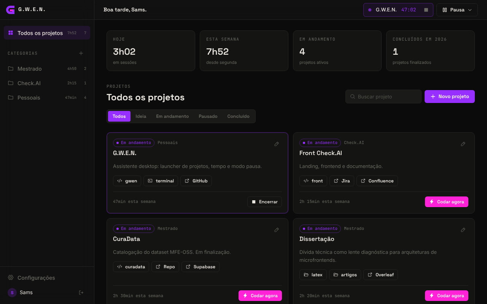
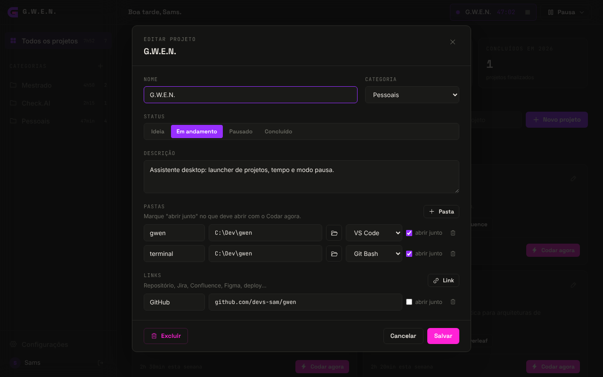
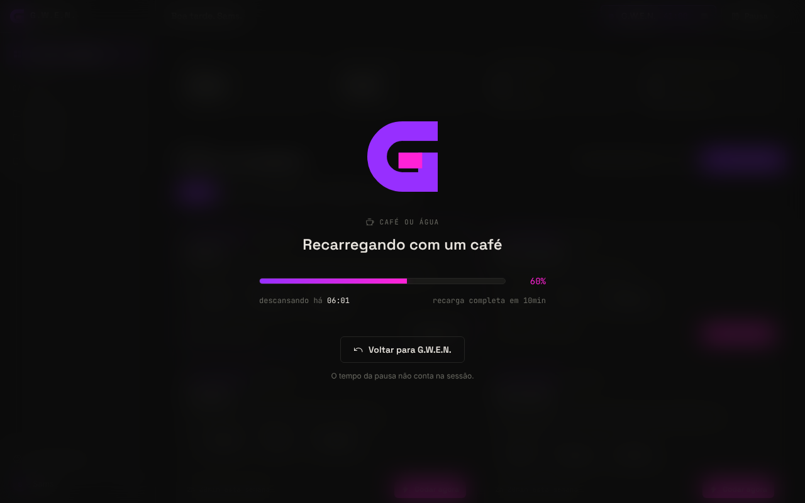
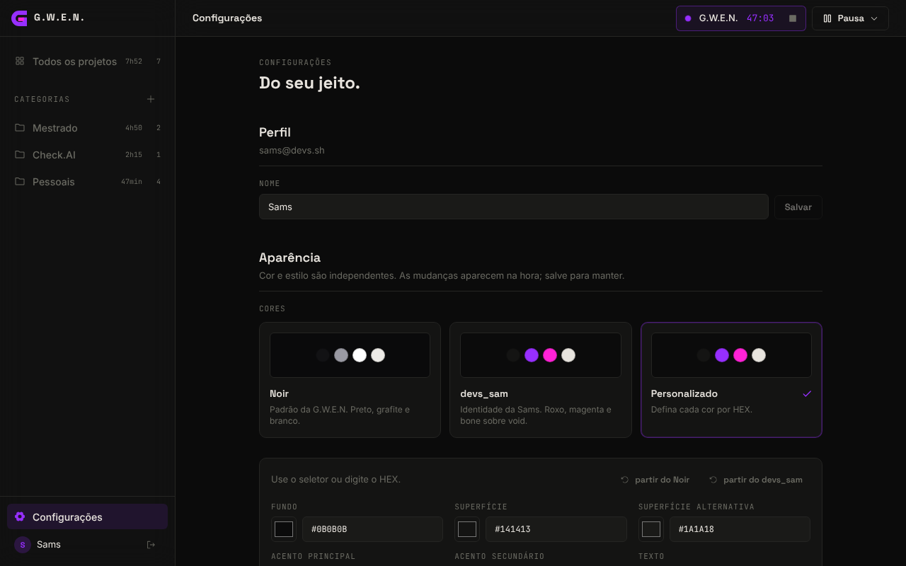
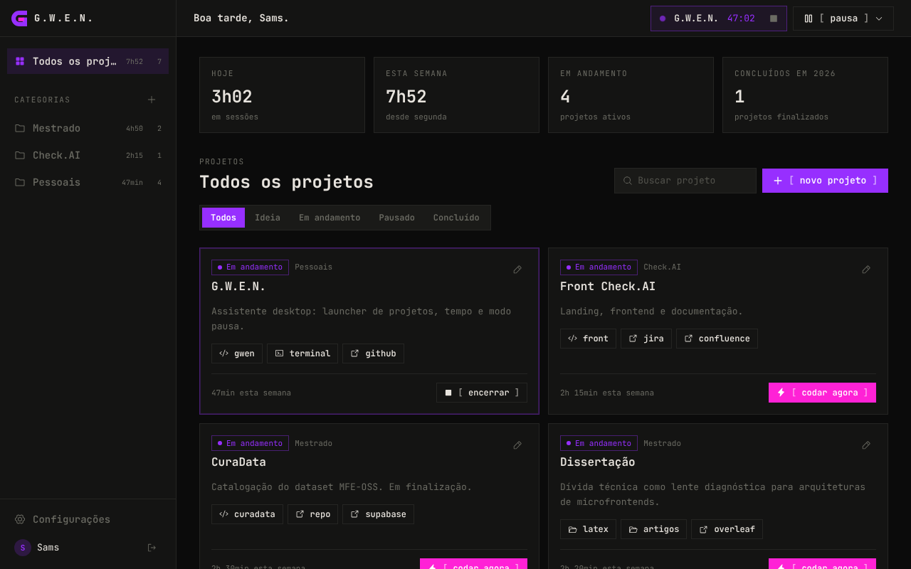

# G.W.E.N.

**Gestão de Wellness, Eficiência e Navegação.** Assistente desktop para quem trabalha com muitos projetos ao mesmo tempo: abre o ambiente de cada projeto com um clique, conta o tempo dedicado a cada um e trata a pausa como parte do trabalho.

Desenvolvido por @devs_sam. Versão `0.1.0` (beta).



---

## Sumário

1. [O que a V1 faz](#o-que-a-v1-faz)
2. [Stack](#stack)
3. [Pré-requisitos no Windows](#pré-requisitos-no-windows)
4. [Configurando o Supabase](#configurando-o-supabase)
5. [Rodando](#rodando)
6. [Gerando o instalador](#gerando-o-instalador)
7. [Como usar](#como-usar)
8. [Temas e personalização](#temas-e-personalização)
9. [Como o tempo é contado](#como-o-tempo-é-contado)
10. [Estrutura do projeto](#estrutura-do-projeto)
11. [Limitações conhecidas](#limitações-conhecidas)
12. [Próximas versões](#próximas-versões)

---

## O que a V1 faz

| Recurso | Descrição |
|---|---|
| **Login** | Conta com e-mail e senha (Supabase Auth). Projetos, tempos e aparência ficam na nuvem. |
| **Categorias** | Agrupe projetos por área: Mestrado, Freela, Pessoais, Estudos. Cada categoria mostra o tempo da semana. |
| **Projetos** | Nome, status (ideia, em andamento, pausado, concluído), descrição, várias pastas e vários links. |
| **Codar agora** | Abre de uma vez as pastas e links marcados como "abrir junto" e inicia a sessão de tempo. |
| **Pastas com ação** | Cada pasta abre no VS Code, no Explorer ou no Git Bash. Pasta de LaTeX ou artigos não precisa abrir no VS Code. |
| **Sessões de tempo** | Tempo por projeto, por categoria, por dia e por semana. Projetos concluídos no ano. |
| **Modo pausa** | Café, refeição, leitura, respiro ou outra. A tela escurece e a barra de energia enche. O tempo de pausa não conta na sessão. |
| **Sessão esquecida** | Se o app foi fechado com uma sessão rodando, ele pergunta quanto tempo foi de verdade na próxima abertura. |
| **Temas** | Noir (padrão), devs_sam e Personalizado por HEX. Estilo Moderno ou Terminal. |

## Stack

- **Tauri 2** (Rust) para a janela desktop e para abrir programas no sistema
- **React 19 + Vite 6**
- **Tailwind CSS 4** lendo os design tokens do projeto
- **Supabase** (Auth + PostgreSQL com RLS)
- **Phosphor Icons**
- Fontes locais via Fontsource: Space Grotesk, Inter e JetBrains Mono (o app funciona sem depender do Google Fonts)

## Pré-requisitos no Windows

Se você já roda o Sparky Notes, provavelmente já tem tudo. Confira no terminal:

```bash
node -v        # 20 ou mais
yarn -v
rustc --version
cargo --version
```

Se faltar algo:

1. **Node.js** LTS: https://nodejs.org
2. **Yarn**: `npm install -g yarn`
3. **Rust**: instale pelo https://rustup.rs (opção padrão)
4. **Microsoft C++ Build Tools**: no instalador do Visual Studio Build Tools, marque **"Desenvolvimento para desktop com C++"**
5. **WebView2**: já vem no Windows 10 e 11

Para o **Codar agora** funcionar:

- O comando `code` precisa estar no PATH. Teste com `code --version`. Se não funcionar, no VS Code abra a paleta (`Ctrl+Shift+P`) e rode *Shell Command: Install 'code' command in PATH*, ou reinstale marcando "Adicionar ao PATH".
- O Git Bash é procurado em `C:\Program Files\Git\git-bash.exe`. Se estiver em outro lugar, ajuste em **Configurações > Sistema**.

## Configurando o Supabase

1. Crie um projeto em https://supabase.com (pode ser no plano gratuito).
2. Vá em **SQL Editor > New query**, cole todo o conteúdo de [`supabase/migrations/001_gwen_init.sql`](supabase/migrations/001_gwen_init.sql) e clique em **Run**. Isso cria as tabelas, as políticas de segurança (cada pessoa só vê os próprios dados) e o perfil automático no cadastro.
3. Copie `.env.example` para `.env` e preencha com os dados de **Project Settings > API**:

   ```env
   VITE_SUPABASE_URL=https://xxxx.supabase.co
   VITE_SUPABASE_ANON_KEY=eyJhbGciOi...
   ```

4. **Opcional, para desenvolvimento:** em **Authentication > Sign In / Providers > Email**, desligue *Confirm email*. Assim a conta entra direto depois do cadastro, sem precisar clicar no link do e-mail.

> O `.env` está no `.gitignore`. A anon key é pública por natureza (a segurança vem do RLS), mas não suba o `.env` mesmo assim.

## Rodando

```bash
yarn          # instala as dependências
yarn app      # abre a G.W.E.N. como app desktop (tauri dev)
```

A primeira execução compila o lado Rust e demora alguns minutos. As seguintes são rápidas.

Para mexer só na interface, sem abrir o app:

```bash
yarn dev      # http://localhost:1420
```

No navegador, os botões de pasta só registram no console (navegador não pode abrir programas) e o seletor de pasta vira um campo de texto. Links abrem numa nova aba.

## Gerando o instalador

```bash
yarn app:build
```

O instalador sai em `src-tauri/target/release/bundle/nsis/` (`.exe`) e `src-tauri/target/release/bundle/msi/` (`.msi`). Outra pessoa só precisa instalar, criar a conta e cadastrar as pastas da máquina dela.

Para trocar o ícone do app, edite `src-tauri/app-icon.svg` e rode:

```bash
yarn tauri icon src-tauri/app-icon.svg
```

## Como usar

### 1. Crie categorias

Na lateral, em **Categorias**, clique no `+`. Selecionando uma categoria, aparecem os botões de renomear e excluir. Excluir uma categoria não apaga os projetos: eles vão para "Sem categoria".

### 2. Cadastre projetos

Clique em **Novo projeto**. Se você estiver dentro de uma categoria, ela já vem selecionada.



- **Pastas:** o ícone de pasta abre o seletor do Windows. Se o nome do projeto estiver vazio, ele usa o nome da pasta. Escolha a ação de cada uma (VS Code, Explorer ou Git Bash) e marque **abrir junto** no que deve abrir com o Codar agora. A mesma pasta pode aparecer duas vezes, uma no VS Code e outra no Git Bash.
- **Links:** GitHub, Jira, Confluence, Overleaf, deploy. Se faltar o `https://`, o app completa.
- Todos os botões de pasta e link também ficam visíveis no card, para abrir um de cada vez.

### 3. Codar agora

Abre o que está marcado, inicia a sessão e mostra o timer na barra superior. Se havia outra sessão ativa, ela é encerrada antes. Projetos em **ideia** ou **pausado** passam para **em andamento**.

Para encerrar, use o quadrado na barra superior ou o botão **Encerrar** no card.

### 4. Pausa

O botão **Pausa** na barra superior abre os tipos de pausa. A barra enche até o tempo de recarga de cada tipo (café 10 min, refeição 45, leitura 25, respiro 5, outra 15), mas chegar a 100% não encerra nada: você volta quando quiser.



Dá para pausar sem sessão ativa também. A pausa fica registrada de qualquer forma.

## Temas e personalização

Em **Configurações > Aparência**, cor e estilo são escolhas independentes. As mudanças aparecem na hora e ficam salvas no perfil ao clicar em **Salvar aparência**.

| Cores | Descrição |
|---|---|
| **Noir** | Padrão da G.W.E.N.: preto, grafite e branco. |
| **devs_sam** | Identidade da Sams: `#972fff` e `#ff22d6` sobre void, texto bone. |
| **Personalizado** | Cada um dos 9 tokens editável por seletor ou HEX. Dá para partir do Noir ou do devs_sam. |

| Estilo | Descrição |
|---|---|
| **Moderno** | Cantos arredondados, vidro na lateral, na barra superior e no modo pausa. |
| **Terminal** | Tudo em JetBrains Mono, cantos retos, sem vidro, botões como `[ comando ]`. |



<table>
<tr>
<td></td>
<td></td>
</tr>
<tr>
<td align="center">Noir + Moderno</td>
<td align="center">devs_sam + Terminal</td>
</tr>
</table>

### Como os tokens funcionam

Os nomes seguem o mesmo padrão do `globals.css` do portfólio:

| Token | Uso |
|---|---|
| `--c-void` | fundo da janela |
| `--c-surface` / `--c-surface-alt` | cards, painéis, inputs |
| `--c-phosphor` | acento principal (seleção, logo, status ativo) |
| `--c-ember` | acento secundário (Codar agora, barra de energia) |
| `--c-bone` | texto |
| `--c-muted` | texto apagado |
| `--c-rule` / `--c-rule-light` | bordas e divisores |

Os derivados (`--c-phosphor-12`, `--c-ember-20`, `--c-void-veil`...) são calculados com `color-mix`, então acompanham qualquer tema sem configuração extra. A cor do texto sobre os acentos é escolhida pelo maior contraste (WCAG), exceto no devs_sam, que usa branco sobre o magenta por decisão da identidade.

Para criar um tema novo fixo, adicione um objeto em `PRESETS` no arquivo `src/lib/themes.js` e o valor no `check` da coluna `theme` no SQL.

## Como o tempo é contado

- **Sessão** = intervalo entre Codar agora e Encerrar, menos as pausas feitas durante ela.
- O tempo de **hoje** e da **semana** (que começa na segunda) considera só a parte da sessão que caiu dentro do período.
- Enquanto o app está aberto, ele registra um sinal a cada minuto (`last_seen_at`). Se ele abrir e encontrar uma sessão sem sinal há mais de 15 minutos, pergunta o que aconteceu:
  - **Encerrar no último sinal**: registra até a última vez que a G.W.E.N. estava aberta.
  - **Eu sei quanto foi**: você informa os minutos trabalhados.
  - **Ainda estou nesse projeto**: continua, e o tempo com o app fechado entra como pausa.

> A V1 mede o tempo que você marcou, não o tempo real dentro de cada programa. A detecção automática de janela ativa é o próximo passo (veja abaixo).

## Estrutura do projeto

```
gwen/
├── src/
│   ├── components/      # Sidebar, Topbar, ProjectCard, ProjectForm, PauseOverlay, Logo, BrandArt...
│   ├── context/         # AuthContext, WorkspaceContext (dados + sessões), ToastContext
│   ├── data/
│   │   └── repository.js  # toda conversa com o Supabase passa por aqui
│   ├── lib/             # themes, time, stats, breaks, native (ponte com o Rust), supabase
│   ├── pages/           # Login, Dashboard, Settings
│   └── styles/index.css # tokens, estilos Moderno/Terminal, componentes
├── src-tauri/
│   ├── src/lib.rs       # comandos nativos: open_folder, path_exists
│   ├── capabilities/    # permissões da janela (opener, dialog)
│   ├── app-icon.svg     # fonte do ícone
│   └── tauri.conf.json
└── supabase/migrations/001_gwen_init.sql
```

**Decisões:**

- **Repository pattern:** trocar o backend ou adicionar cache local (SQLite) mexe só em `src/data/repository.js`.
- **Lado nativo mínimo:** o Rust só faz o que o navegador não pode (abrir VS Code, Explorer e Git Bash). Links usam o plugin `opener` do Tauri.
- **Vidro só onde faz sentido:** lateral, barra superior e modo pausa. Cards e listas são sólidos para não atrapalhar a leitura.
- **Sem estado global pesado:** Context API dá conta do tamanho da V1. Se crescer, migra para Redux Toolkit sem mudar os componentes que usam os hooks `useWorkspace` e `useAuth`.

## Limitações conhecidas

- **Caminhos de pasta são por máquina.** Se você usar a mesma conta em dois computadores, as pastas cadastradas num podem não existir no outro. O app avisa quando a pasta não é encontrada.
- **Login só com e-mail e senha.** Google OAuth em app desktop precisa de deep link para voltar ao app depois do navegador. Fica para depois.
- **Sem modo claro.** O Noir e o devs_sam são escuros. Um tema claro pode ser criado no Personalizado.
- **Uma sessão por vez.** Começar outro projeto encerra o atual.
- **Precisa de internet** para salvar e carregar dados.

## Próximas versões

- [ ] **Detecção automática de janela ativa**: tempo real em VS Code, Jira, Confluence, YouTube (Rust, consultando a janela em foco a cada poucos segundos)
- [ ] **Widget flutuante**: barra pequena "sempre no topo" com o timer e a energia, para usar junto com outras janelas
- [ ] **Modo saúde (opcional)**: lembretes de água e alongamento, check-in de humor, alertas de excesso de horas
- [ ] **Dias sem uso** registrados como descanso
- [ ] Histórico e gráficos por mês e por ano
- [ ] Google OAuth
- [ ] Cache local para funcionar offline

---

<sub>Feito por @devs_sam · Tauri + React + Supabase</sub>
