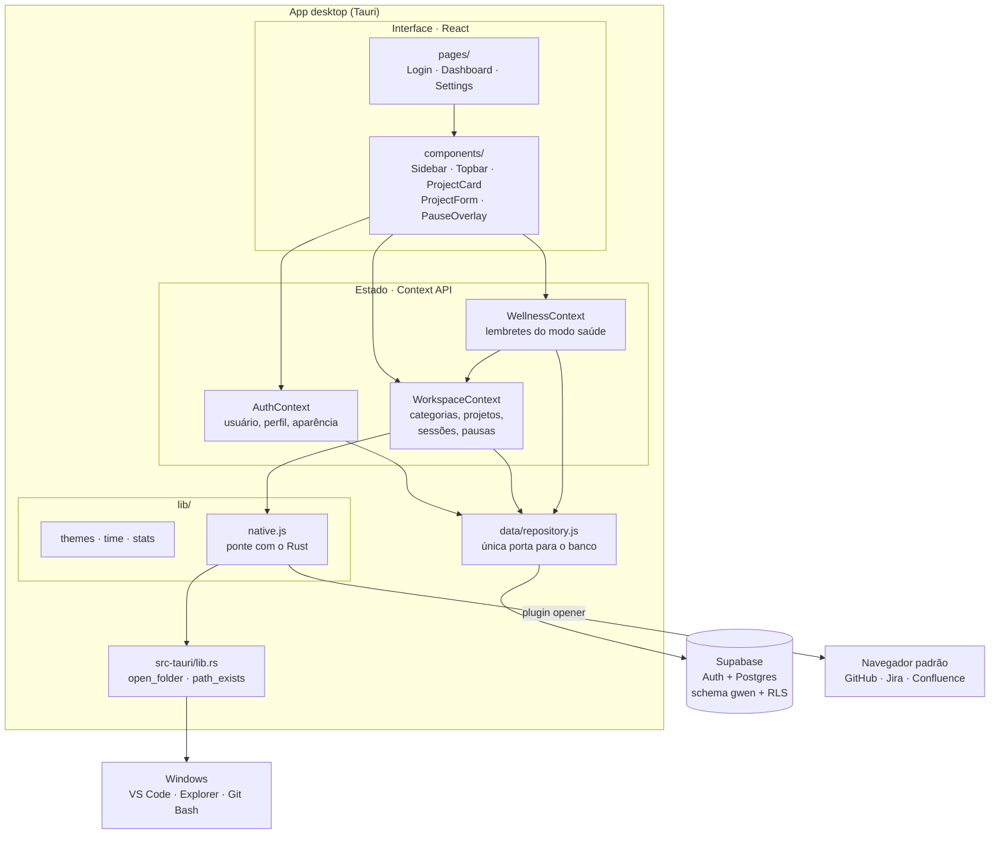
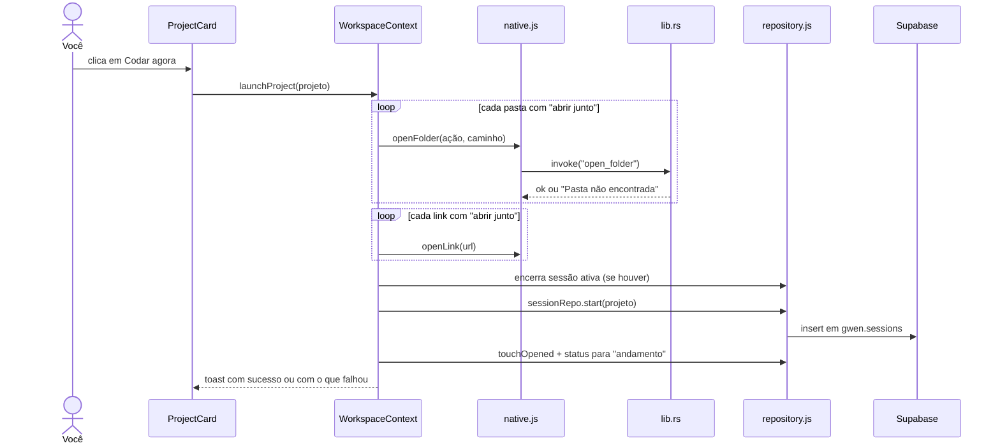
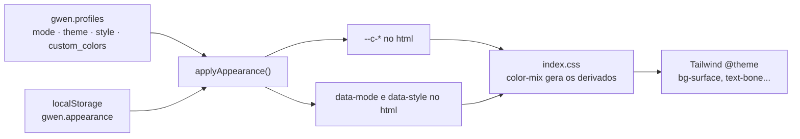

# ARQ-001 · Visão geral da arquitetura

| Código | Tipo | Status | Versão do app | Atualizado |
|---|---|---|---|---|
| `ARQ-001` | Arquitetura | Vigente | 0.3.0 | 17/10/2026 |

**Relacionados:** [`DAT-001`](DAT-001-modelo-de-dados.md) · [`ADR-001`](decisoes/ADR-001-tauri-em-vez-de-electron.md) · [`ADR-002`](decisoes/ADR-002-schema-proprio-em-projeto-compartilhado.md) · [`ADR-005`](decisoes/ADR-005-context-api-na-v1.md) · [`ADR-006`](decisoes/ADR-006-login-google-por-deep-link.md) · [`ADR-007`](decisoes/ADR-007-modo-claro-como-terceiro-eixo.md)

---

### $ em uma frase

A G.W.E.N. é um app **Tauri** com interface em **React**. O lado nativo (Rust) só abre programas no Windows. Os dados vivem no **Supabase**, num schema próprio, e toda leitura e escrita passa por uma única camada de repositório.

### $ camadas

| Camada | Responsabilidade | Não faz |
|---|---|---|
| `pages/` e `components/` | Renderizar e capturar intenção do usuário | Falar com o banco ou com o sistema |
| `context/` | Estado da sessão de uso e regras de negócio (iniciar sessão, pausar, corrigir sessão esquecida, lembretes de saúde) | Montar queries |
| `data/repository.js` | Todas as queries do Supabase | Regras de negócio |
| `lib/native.js` | Chamar comandos Rust e plugins do Tauri, com fallback no navegador | Saber o que é um projeto |
| `src-tauri/src/lib.rs` | Abrir pastas em programas do Windows | Rede, banco, links |

A regra que mais importa: **componente não importa `supabase` direto**. Se um dia o backend mudar, ou entrar um cache local, só o `repository.js` muda.

### $ fluxo do "Codar agora"

Falha ao abrir uma pasta **não** impede a sessão de começar. Os erros são juntados e mostrados num único aviso, para você saber o que corrigir no cadastro.

### $ ciclo de vida do tempo

Enquanto o app está aberto com uma sessão ativa, o `WorkspaceContext` atualiza `last_seen_at` a cada 60 segundos. Na abertura, uma sessão sem sinal há mais de 15 minutos é tratada como **esquecida** e abre o modal de correção. Detalhes das regras de cálculo em [`DAT-001`](DAT-001-modelo-de-dados.md#-regras-de-tempo).

### $ temas

- A aparência salva no `localStorage` é aplicada antes do login, para o tema não piscar.
- `applyAppearance()` escreve os tokens `--c-*` no `<html>`. Os derivados (`--c-phosphor-12`, `--c-void-veil`...) são `color-mix` no CSS e recalculam sozinhos.
- O modo (escuro, claro ou sistema) escolhe qual paleta da cor é usada e vira `data-mode`. No modo sistema, a troca de tema do Windows é aplicada na hora.
- O estilo (Moderno ou Terminal) é o atributo `data-style`, que troca fonte, raio, blur e o formato dos botões.
- A classe `.noir` força a identidade do sistema numa área específica (painel do login), qualquer que seja o tema.

Motivação em [`ADR-004`](decisoes/ADR-004-identidade-noir-e-temas-por-tokens.md) e [`ADR-007`](decisoes/ADR-007-modo-claro-como-terceiro-eixo.md).

### $ login

E-mail e senha vão direto ao Supabase Auth. O login com Google abre no navegador do sistema e volta para o app pelo deep link `gwen://auth/callback`, com PKCE. O fluxo completo está em [`ADR-006`](decisoes/ADR-006-login-google-por-deep-link.md).

### $ segurança

- **RLS em todas as tabelas:** cada linha tem `user_id` (ou `id`, no perfil) e só o dono lê e escreve. A anon key no app é pública por natureza; a proteção está no banco.
- **Permissões do Tauri mínimas:** a janela só tem `core:default`, `opener:default`, `dialog:default`, `deep-link:default` e `notification:default` (`src-tauri/capabilities/default.json`). Não há acesso livre a shell no frontend: abrir programas passa por dois comandos Rust com ações fixas (`vscode`, `explorer`, `gitbash`).
- **O caminho é validado no Rust** antes de qualquer execução (`Path::exists`).

### $ o que fica para depois

| Tema | Por que não agora | Onde entraria |
|---|---|---|
| Detecção da janela ativa | Exige polling em Rust e regras por programa | novo comando em `lib.rs` + tabela de uso por app |
| Widget flutuante | Segunda janela Tauri, sempre no topo | `tauri.conf.json` + rota própria |
| Cache local / offline | V1 depende de internet | implementação alternativa do `repository.js` |
