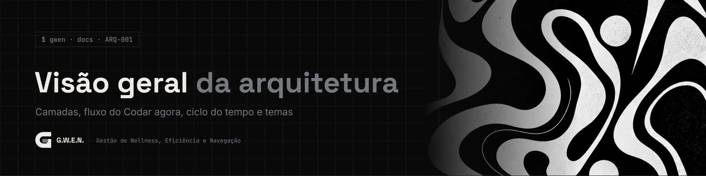
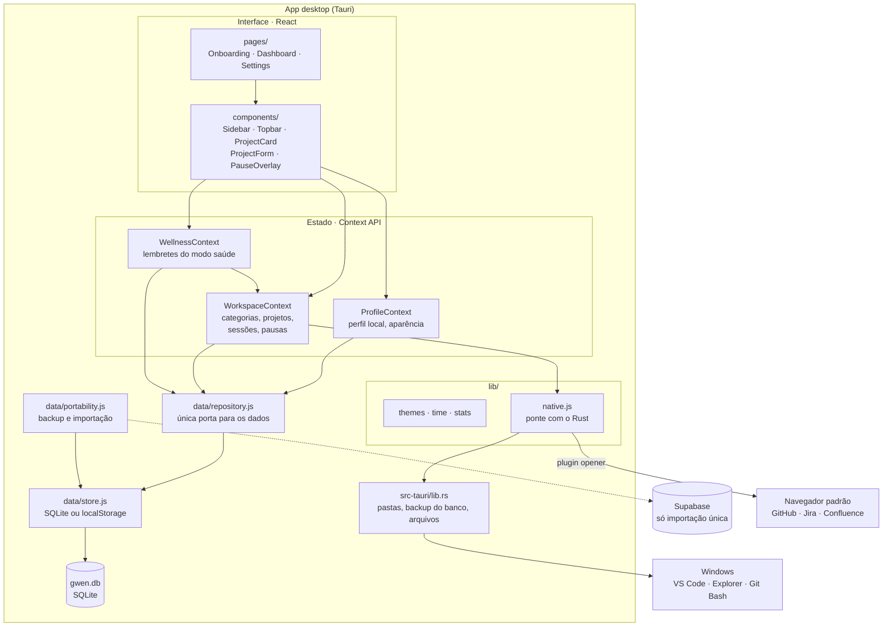
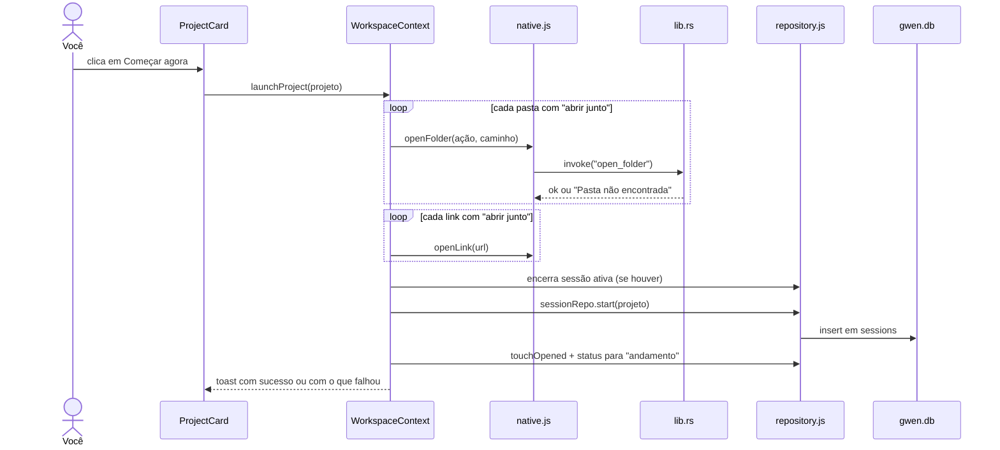
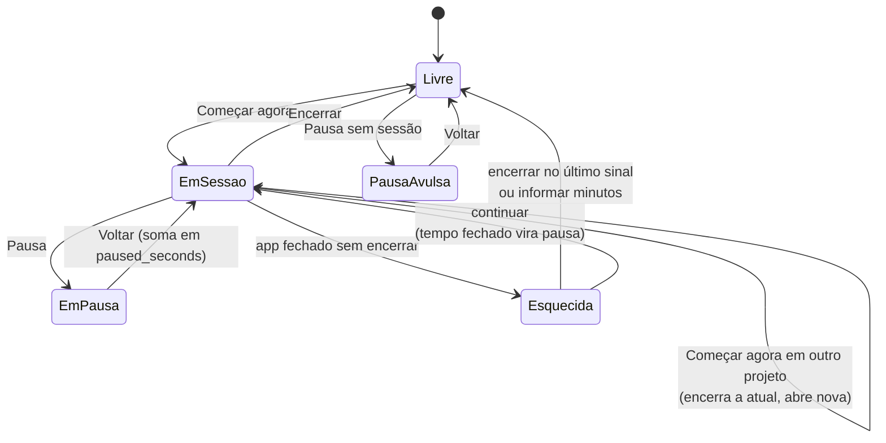

<picture>
  <source media="(prefers-color-scheme: light)" srcset="../_assets/banners/docs/arq-001-claro.webp">
  
</picture>

# ARQ-001 · Visão geral da arquitetura

  

| Campo | Valor |
|---|---|
| Código | `ARQ-001` |
| Data | sábado, 17/10/2026 |
| Tipo | Arquitetura |
| Status | Vigente |
| Versão do app | 0.4.0 |
| Redigido por | Samara Silvia |
| Referências | [`DAT-001`](DAT-001-modelo-de-dados.md) · [`ADR-001`](decisoes/ADR-001-tauri-em-vez-de-electron.md) · [`ADR-002`](decisoes/ADR-002-schema-proprio-em-projeto-compartilhado.md) · [`ADR-005`](decisoes/ADR-005-context-api-na-v1.md) · [`ADR-006`](decisoes/ADR-006-login-google-por-deep-link.md) · [`ADR-007`](decisoes/ADR-007-modo-claro-como-terceiro-eixo.md) · [`ADR-009`](decisoes/ADR-009-atualizacoes-sem-perder-dados.md) · [`ADR-010`](decisoes/ADR-010-dados-locais-primeiro.md) |
| Histórico | [ver alterações](https://github.com/SamaraSilvia81/gwen-app/commits/main/docs/ARQ-001-visao-geral.md) |

**Sumário**

1. [Em uma frase](#-em-uma-frase)
2. [Camadas](#-camadas)
3. [Fluxo do "Começar agora"](#-fluxo-do-começar-agora)
4. [Ciclo de vida do tempo](#-ciclo-de-vida-do-tempo)
5. [Temas](#-temas)
6. [Dados locais e nuvem](#-dados-locais-e-nuvem)
7. [Segurança](#-segurança)
8. [Atualizações](#-atualizações)
9. [O que fica para depois](#-o-que-fica-para-depois)

---

### $ em uma frase

A G.W.E.N. é um app **Tauri** com interface em **React**. O lado nativo (Rust) só abre programas no Windows. Os dados ficam **no computador**, num SQLite, e toda leitura e escrita passa por uma única camada de repositório. O Supabase só aparece para importar dados de versões antigas.

### $ camadas

| Camada | Responsabilidade | Não faz |
|---|---|---|
| `pages/` e `components/` | Renderizar e capturar intenção do usuário | Falar com o banco ou com o sistema |
| `context/` | Estado da sessão de uso e regras de negócio (iniciar sessão, pausar, corrigir sessão esquecida, lembretes de saúde) | Montar queries |
| `data/repository.js` | Ler e gravar cada entidade, com a integridade que antes era do banco (uma sessão ativa, apagar sessões junto com o projeto) | Regras de uso (pausar, corrigir sessão) |
| `data/store.js` | Cinco operações genéricas sobre o SQLite (app) ou o `localStorage` (navegador) | Saber o que é um projeto |
| `data/portability.js` | Backup em JSON e importação única da nuvem, sempre só acrescentando | Apagar dados |
| `lib/native.js` | Chamar comandos Rust e plugins do Tauri, com fallback no navegador | Saber o que é um projeto |
| `src-tauri/src/lib.rs` | Abrir pastas em programas do Windows, migrações e cópia do banco a cada versão, ler e gravar o JSON de backup | Rede, links |

A regra que mais importa: **componente não fala com o banco**. Foi o que permitiu trocar o Supabase pelo SQLite na 0.4 sem mexer em contexto nenhum, e é o que vai permitir ligar a sincronização depois.

### $ fluxo do "Começar agora"

Falha ao abrir uma pasta **não** impede a sessão de começar. Os erros são juntados e mostrados num único aviso, para você saber o que corrigir no cadastro.

### $ ciclo de vida do tempo

Enquanto o app está aberto com uma sessão ativa, o `WorkspaceContext` atualiza `last_seen_at` a cada 60 segundos. Na abertura, uma sessão sem sinal há mais de 15 minutos é tratada como **esquecida** e abre o modal de correção. Detalhes das regras de cálculo em [`DAT-001`](DAT-001-modelo-de-dados.md#-regras-de-tempo).

### $ temas

- A aparência salva no `localStorage` é aplicada antes de o banco abrir, para o tema não piscar.
- `applyAppearance()` escreve os tokens `--c-*` no `<html>`. Os derivados (`--c-phosphor-12`, `--c-void-veil`...) são `color-mix` no CSS e recalculam sozinhos.
- O modo (escuro, claro ou sistema) escolhe qual paleta da cor é usada e vira `data-mode`. No modo sistema, a troca de tema do Windows é aplicada na hora.
- O estilo (Moderno ou Terminal) é o atributo `data-style`, que troca fonte, raio, blur e o formato dos botões.
- A classe `.noir` força a identidade do sistema numa área específica (painel da primeira abertura), qualquer que seja o tema.

Motivação em [`ADR-004`](decisoes/ADR-004-identidade-noir-e-temas-por-tokens.md) e [`ADR-007`](decisoes/ADR-007-modo-claro-como-terceiro-eixo.md).

### $ dados locais e nuvem

Não há login. A primeira abertura pede só o nome e cria o perfil local. Tudo fica em `gwen.db`, na pasta de dados do app, e a cada versão nova o Rust copia o banco para `backups/` antes das migrações. A nuvem aparece só em **Configurações > Dados > Importar da nuvem** (quando o app tem as variáveis do Supabase): entra na conta antiga com Google (deep link `gwen://auth/callback`, ver [`ADR-006`](decisoes/ADR-006-login-google-por-deep-link.md)) ou e-mail, copia tudo e sai. Motivação em [`ADR-010`](decisoes/ADR-010-dados-locais-primeiro.md).

### $ segurança

- **Dados do usuário, pasta do usuário:** o banco fica na pasta de dados da conta do Windows. Não há outras pessoas no mesmo banco, então não há RLS local; na nuvem (importação), o RLS do Supabase continua valendo.
- **Permissões do Tauri mínimas:** a janela só tem `core:default`, `opener:default`, `dialog:default`, `deep-link:default`, `notification:default`, `updater:default`, `process:allow-restart`, `sql:default` e `sql:allow-execute` (`src-tauri/capabilities/default.json`). Não há acesso livre a shell no frontend: abrir programas passa por dois comandos Rust com ações fixas (`vscode`, `explorer`, `gitbash`).
- **O caminho é validado no Rust** antes de qualquer execução (`Path::exists`). Ler e gravar arquivo só aceita `.json` escolhido pelo seletor do sistema.

### $ atualizações

A G.W.E.N. procura versão nova nas Releases do GitHub ao abrir e a cada 6 horas, e só instala com clique. O instalador é assinado e os dados ficam fora da pasta do programa. Detalhes em [`ADR-009`](decisoes/ADR-009-atualizacoes-sem-perder-dados.md).

### $ o que fica para depois

| Tema | Por que não agora | Onde entraria |
|---|---|---|
| Detecção da janela ativa | Exige polling em Rust e regras por programa | novo comando em `lib.rs` + tabela de uso por app |
| Widget flutuante | Segunda janela Tauri, sempre no topo | `tauri.conf.json` + rota própria |
| Sincronização entre computadores | Primeiro o local precisa estar sólido; exige modelo de conflito | `portability.js` vira sync, com o mesmo `store` |

---

<picture>
  <source media="(prefers-color-scheme: light)" srcset="../_assets/banners/docs/rodape-claro.webp">
  
</picture>
