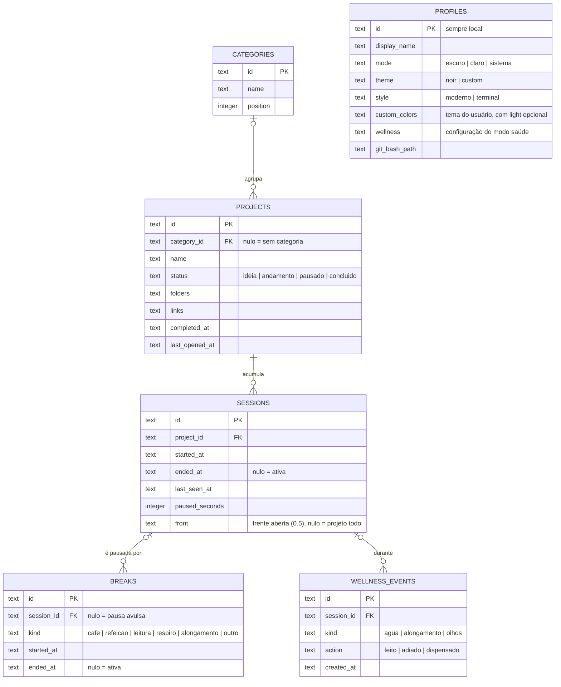

<picture>
  <source media="(prefers-color-scheme: light)" srcset="../_assets/banners/docs/dat-001-claro.webp">
  
</picture>

# DAT-001 · Modelo de dados

  

| Campo | Valor |
|---|---|
| Código | `DAT-001` |
| Data | sábado, 17/10/2026 |
| Tipo | Dados |
| Status | Vigente |
| Versão do app | 0.4.0 |
| Redigido por | Samara Silvia |
| Referências | [`ARQ-001`](ARQ-001-visao-geral.md) · [`ADR-002`](decisoes/ADR-002-schema-proprio-em-projeto-compartilhado.md) · [`ADR-003`](decisoes/ADR-003-tempo-por-sessao-manual-na-v1.md) · migrações: [`001_gwen_init.sql`](../supabase/migrations/001_gwen_init.sql), [`002_gwen_modo_claro.sql`](../supabase/migrations/002_gwen_modo_claro.sql), [`003_gwen_wellness.sql`](../supabase/migrations/003_gwen_wellness.sql) · [`ADR-010`](decisoes/ADR-010-dados-locais-primeiro.md) · banco local: [`001_local.sql`](../src-tauri/migrations/001_local.sql) |
| Histórico | [ver alterações](https://github.com/SamaraSilvia81/gwen-app/commits/main/docs/DAT-001-modelo-de-dados.md) |

**Sumário**

1. [Onde mora](#-onde-mora)
2. [Diagrama](#-diagrama)
3. [Tabelas](#-tabelas)
4. [Invariantes](#-invariantes)
5. [Regras de tempo](#-regras-de-tempo)
6. [Evoluções previstas](#-evoluções-previstas)

---

### $ onde mora

Desde a 0.4, os dados ficam **no computador**, no arquivo `gwen.db` (SQLite) dentro da pasta de dados do app (`%APPDATA%\sh.devs-sam.gwen` no Windows). O esquema local está em [`src-tauri/migrations/001_local.sql`](../src-tauri/migrations/001_local.sql) e é aplicado pelo plugin `sql` do Tauri. Ver [`ADR-010`](decisoes/ADR-010-dados-locais-primeiro.md).

| Onde | O quê |
|---|---|
| `gwen.db` (SQLite) | perfil, categorias, projetos, sessões, pausas, eventos do modo saúde, `meta` |
| `backups/gwen-<versão>-<data>.db` | cópia automática feita a cada versão nova, antes das migrações (as 5 mais recentes) |
| `localStorage` da webview | só conveniências: aparência antes do banco abrir e contadores do modo saúde |
| Supabase, schema `gwen` | dados das versões até a 0.3, lidos uma vez pela importação. Esquema em [`supabase/migrations/`](../supabase/migrations/) |

No banco local, ids são UUID em texto, datas são ISO 8601 em texto e campos estruturados (`folders`, `links`, `custom_colors`, `wellness`) são JSON em texto. As tabelas têm as mesmas colunas da versão na nuvem, menos `user_id`: num banco que é de uma pessoa só, ele não é necessário. Isso mantém a importação direta, linha por linha.

### $ diagrama



### $ tabelas

**`profiles`**: uma linha só, com `id = 'local'`, criada na primeira abertura com o nome escolhido. Guarda aparência, modo saúde e o caminho do Git Bash.

**`categories`**: agrupamento livre. Excluir uma categoria **não apaga** projetos: o repositório limpa o `category_id` deles, e eles aparecem em "Sem categoria".

**`projects`**: pastas e links ficam em JSON dentro do próprio projeto, porque sempre são lidos e salvos juntos com ele e não são consultados isoladamente.

```json
"folders": [
  { "label": "landing", "path": "C:\\Dev\\checkai-lp", "actions": ["vscode", "gitbash"], "action": "vscode", "on_launch": true, "front": "Landing" },
  { "label": "plataforma", "path": "C:\\Dev\\checkai-app", "actions": ["vscode"], "action": "vscode", "on_launch": true, "front": "Plataforma" }
],
"links": [
  { "label": "GitHub", "url": "https://github.com/...", "on_launch": false, "front": "" }
]
```

| Campo | Regra |
|---|---|
| `status` | Vira `andamento` automaticamente quando um projeto em `ideia` ou `pausado` é aberto pelo Começar agora |
| `completed_at` | Preenchido ao mudar para `concluido`, limpo ao sair desse status. É o que conta em "Concluídos no ano" |
| `last_opened_at` | Atualizado a cada Começar agora. Ordena a lista dentro de cada status |
| `folders[].path` | Caminho absoluto **da máquina onde foi cadastrado**. Em outro computador pode não existir |
| `folders[].actions` | Com o que a pasta abre (0.5). Projetos da 0.4 só têm `action`; quem lê usa `actions` e cai em `[action]`. `action` continua gravado com a primeira ação, para versões antigas seguirem lendo |
| `front` | Frente do item (0.5), opcional. Vazio = vale para todas. As frentes do projeto são as que aparecem nos itens, sem tabela própria. Regras em `src/lib/projectModel.js` |

**`sessions`**: um intervalo de trabalho num projeto. Desde a 0.5, `front` guarda a frente aberta no Começar agora (nulo quando o projeto foi aberto inteiro), para somar o tempo por frente.

**`breaks`**: uma pausa, ligada à sessão ativa no momento (ou avulsa).

**`meta`**: chave e valor para controle interno, como `cloud_import_at` (quando a importação da nuvem foi feita).

**`wellness_events`**: cada resposta a um lembrete do modo saúde (`kind`: agua, alongamento, olhos; `action`: feito, adiado, dispensado), com a sessão em que aconteceu. Os contadores dos intervalos não ficam aqui: ficam no `localStorage` da máquina (ver [`ADR-008`](decisoes/ADR-008-lembretes-por-tempo-de-trabalho.md)).

### $ invariantes

| Regra | Garantida por |
|---|---|
| No máximo **uma sessão ativa** | `sessionRepo.start` encerra a ativa antes de abrir outra |
| No máximo **uma pausa ativa** | `breakRepo.start` encerra a ativa antes de abrir outra |
| Apagar projeto apaga as sessões dele | `projectRepo.remove`; pausas e eventos só perdem o vínculo com a sessão |
| Apagar categoria não apaga projetos | `categoryRepo.remove` limpa o `category_id` |
| Importar nunca sobrescreve | `portability.js` só insere linhas cujo `id` ainda não existe |

Na nuvem essas regras eram do banco (índices únicos, chaves estrangeiras, RLS). No local, ficam no repositório, que é a única porta de escrita.

### $ regras de tempo

**Tempo de uma sessão**

```text
efetivo = (ended_at ou agora) - started_at - paused_seconds - (pausa em andamento, se houver)
```

**Hoje e semana.** A semana começa na segunda-feira. Quando uma sessão começou antes do período, entra só a parte proporcional que caiu dentro dele (`sessionSecondsSince` em `src/lib/time.js`). As pausas são consideradas distribuídas ao longo da sessão.

**Pausas.** Ao voltar de uma pausa ligada a uma sessão, a duração dela é somada em `sessions.paused_seconds`. Pausas avulsas ficam registradas em `breaks`, mas não afetam nenhuma sessão.

**Sessão esquecida.** Com o app aberto e uma sessão ativa, `last_seen_at` é atualizado a cada 60 segundos. Na abertura, se `agora - last_seen_at > 15 min`:

| Escolha | O que grava |
|---|---|
| Encerrar no último sinal | `ended_at = last_seen_at` |
| Eu sei quanto foi | `ended_at = started_at + minutos + paused_seconds` |
| Ainda estou nesse projeto | soma `agora - last_seen_at` em `paused_seconds` e mantém a sessão aberta |

Se havia uma pausa ativa, ela é encerrada no mesmo instante escolhido (ou no início dela, se o instante for anterior).

### $ evoluções previstas

- **Uso por programa** (detecção de janela ativa): nova tabela local `app_usage (id, category, app, started_at, ended_at)`, guardando a categoria e o programa, nunca o título da janela, independente das sessões.
- **Caminhos por máquina:** com a sincronização, `folders[].path` passa para uma tabela `folder_paths (folder_id, device_id, path)`, porque o mesmo projeto tem caminhos diferentes em cada computador.
- **Dias de descanso:** pode ser derivado das sessões (dias sem nenhuma), sem tabela nova.

---

<picture>
  <source media="(prefers-color-scheme: light)" srcset="../_assets/banners/docs/rodape-claro.webp">
  
</picture>
