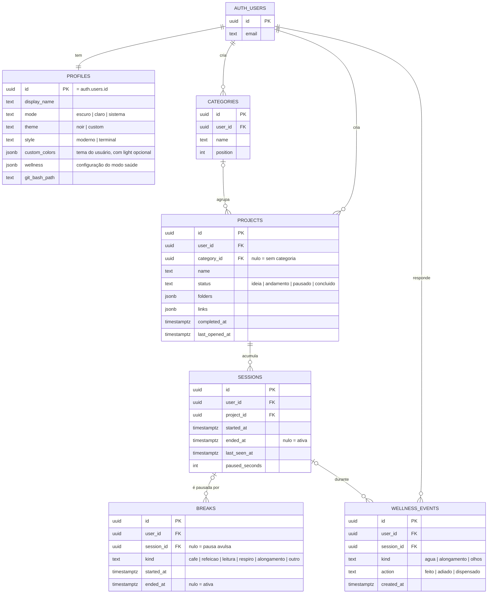

# DAT-001 · Modelo de dados

| Código | Tipo | Status | Versão do app | Atualizado |
|---|---|---|---|---|
| `DAT-001` | Dados | Vigente | 0.3.0 | 17/10/2026 |

**Relacionados:** [`ARQ-001`](ARQ-001-visao-geral.md) · [`ADR-002`](decisoes/ADR-002-schema-proprio-em-projeto-compartilhado.md) · [`ADR-003`](decisoes/ADR-003-tempo-por-sessao-manual-na-v1.md) · migrações: [`001_gwen_init.sql`](../supabase/migrations/001_gwen_init.sql), [`002_gwen_modo_claro.sql`](../supabase/migrations/002_gwen_modo_claro.sql), [`003_gwen_wellness.sql`](../supabase/migrations/003_gwen_wellness.sql)

---

### $ onde mora

Todas as tabelas ficam no schema **`gwen`** de um projeto Supabase que pode ser compartilhado com outros apps. O login (`auth.users`) é do projeto inteiro; o resto é isolado no schema e protegido por RLS.

### $ diagrama



### $ tabelas

**`gwen.profiles`**: uma linha por pessoa, com o mesmo `id` do `auth.users`. É criada pelo próprio app no primeiro login (`profileRepo.ensure`), com `upsert` que ignora duplicado. Não há trigger em `auth.users` para não interferir nos outros apps do projeto.

**`gwen.categories`**: agrupamento livre. Excluir uma categoria **não apaga** projetos: a chave estrangeira usa `on delete set null` e eles aparecem em "Sem categoria".

**`gwen.projects`**: pastas e links ficam em JSON dentro do próprio projeto, porque sempre são lidos e salvos juntos com ele e não são consultados isoladamente.

```json
"folders": [
  { "label": "gwen", "path": "C:\\Dev\\gwen", "action": "vscode", "on_launch": true },
  { "label": "terminal", "path": "C:\\Dev\\gwen", "action": "gitbash", "on_launch": true }
],
"links": [
  { "label": "GitHub", "url": "https://github.com/...", "on_launch": false }
]
```

| Campo | Regra |
|---|---|
| `status` | Vira `andamento` automaticamente quando um projeto em `ideia` ou `pausado` é aberto pelo Codar agora |
| `completed_at` | Preenchido ao mudar para `concluido`, limpo ao sair desse status. É o que conta em "Concluídos no ano" |
| `last_opened_at` | Atualizado a cada Codar agora. Ordena a lista dentro de cada status |
| `folders[].path` | Caminho absoluto **da máquina onde foi cadastrado**. Em outro computador pode não existir |

**`gwen.sessions`**: um intervalo de trabalho num projeto.

**`gwen.breaks`**: uma pausa, ligada à sessão ativa no momento (ou avulsa).

**`gwen.wellness_events`**: cada resposta a um lembrete do modo saúde (`kind`: agua, alongamento, olhos; `action`: feito, adiado, dispensado), com a sessão em que aconteceu. Os contadores dos intervalos não ficam aqui: ficam no `localStorage` da máquina (ver [`ADR-008`](decisoes/ADR-008-lembretes-por-tempo-de-trabalho.md)).

### $ invariantes

| Regra | Garantida por |
|---|---|
| No máximo **uma sessão ativa** por pessoa | índice único parcial `sessions_one_active (user_id) where ended_at is null` |
| No máximo **uma pausa ativa** por pessoa | índice único parcial `breaks_one_active (user_id) where ended_at is null` |
| Cada pessoa só vê os próprios dados | RLS com `user_id = auth.uid()` em todas as tabelas |
| `user_id` nunca vem do cliente | `default auth.uid()` na coluna + `with check` na política |

O app também respeita as duas primeiras regras na lógica (encerra a sessão atual antes de abrir outra), mas o banco é a última barreira.

### $ regras de tempo

**Tempo de uma sessão**

```text
efetivo = (ended_at ou agora) - started_at - paused_seconds - (pausa em andamento, se houver)
```

**Hoje e semana.** A semana começa na segunda-feira. Quando uma sessão começou antes do período, entra só a parte proporcional que caiu dentro dele (`sessionSecondsSince` em `src/lib/time.js`). As pausas são consideradas distribuídas ao longo da sessão.

**Pausas.** Ao voltar de uma pausa ligada a uma sessão, a duração dela é somada em `sessions.paused_seconds`. Pausas avulsas ficam registradas em `breaks`, mas não afetam nenhuma sessão.

**Sessão esquecida.** Com o app aberto e uma sessão ativa, `last_seen_at` é atualizado a cada 60 segundos. Na abertura, se `agora - last_seen_at > 15 min`:

| Escolha | O que grava |
|---|---|
| Encerrar no último sinal | `ended_at = last_seen_at` |
| Eu sei quanto foi | `ended_at = started_at + minutos + paused_seconds` |
| Ainda estou nesse projeto | soma `agora - last_seen_at` em `paused_seconds` e mantém a sessão aberta |

Se havia uma pausa ativa, ela é encerrada no mesmo instante escolhido (ou no início dela, se o instante for anterior).

### $ evoluções previstas

- **Uso por programa** (detecção de janela ativa): nova tabela `gwen.app_usage (user_id, app, title, started_at, ended_at)`, independente das sessões.
- **Caminhos por máquina:** mover `folders[].path` para uma tabela `gwen.folder_paths (folder_id, device_id, path)` se o uso em mais de um computador virar realidade.
- **Dias de descanso:** pode ser derivado das sessões (dias sem nenhuma), sem tabela nova.
