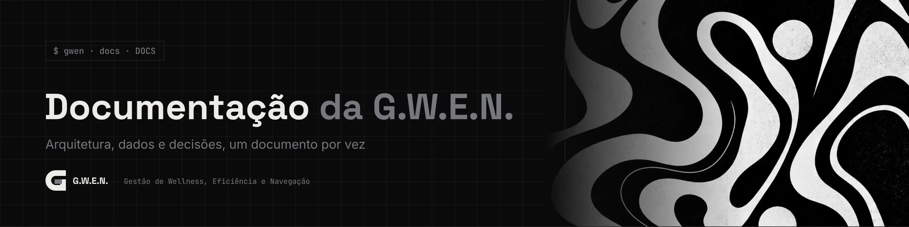

<picture>
  <source media="(prefers-color-scheme: light)" srcset="../_assets/banners/docs/docs-indice-claro.webp">
  
</picture>

# Documentação da G.W.E.N.

  

| Campo | Valor |
|---|---|
| Atualizado | sábado, 17/10/2026 |
| Redigido por | Samara Silvia |
| Banners | gerados em [`_assets/gerador/banners-docs.html`](../_assets/gerador/banners-docs.html) |

**Sumário**

1. [Documentos](#-documentos)
2. [Como os documentos se organizam](#-como-os-documentos-se-organizam)
3. [Padrão de cada documento](#-padrão-de-cada-documento)
4. [Criando um documento novo](#-criando-um-documento-novo)

---

### $ documentos

| Código | Título | Tipo | Status |
|---|---|---|---|
| [`ARQ-001`](ARQ-001-visao-geral.md) | Visão geral da arquitetura | Arquitetura | Vigente |
| [`DAT-001`](DAT-001-modelo-de-dados.md) | Modelo de dados | Dados | Vigente |
| [`ADR-001`](decisoes/ADR-001-tauri-em-vez-de-electron.md) | Tauri em vez de Electron | Decisão | Aceita |
| [`ADR-002`](decisoes/ADR-002-schema-proprio-em-projeto-compartilhado.md) | Schema próprio num projeto Supabase compartilhado | Decisão | Aceita |
| [`ADR-003`](decisoes/ADR-003-tempo-por-sessao-manual-na-v1.md) | Tempo por sessão manual na V1 | Decisão | Aceita |
| [`ADR-004`](decisoes/ADR-004-identidade-noir-e-temas-por-tokens.md) | Identidade Noir e temas por tokens | Decisão | Aceita |
| [`ADR-005`](decisoes/ADR-005-context-api-na-v1.md) | Context API na V1 | Decisão | Aceita |
| [`ADR-006`](decisoes/ADR-006-login-google-por-deep-link.md) | Login com Google por deep link | Decisão | Aceita |
| [`ADR-007`](decisoes/ADR-007-modo-claro-como-terceiro-eixo.md) | Modo claro como terceiro eixo da aparência | Decisão | Aceita |
| [`ADR-008`](decisoes/ADR-008-lembretes-por-tempo-de-trabalho.md) | Lembretes de saúde por tempo de trabalho | Decisão | Aceita |
| [`ADR-009`](decisoes/ADR-009-atualizacoes-sem-perder-dados.md) | Atualizações sem perder dados | Decisão | Aceita |
| [`ADR-010`](decisoes/ADR-010-dados-locais-primeiro.md) | Dados locais primeiro | Decisão | Aceita |

### $ como os documentos se organizam

| Prefixo | Tipo | Pasta | Quando criar |
|---|---|---|---|
| `ARQ` | Arquitetura | `docs/` | Visão de como as partes se encaixam. Muda pouco |
| `DAT` | Dados | `docs/` | Tabelas, relações, regras de cálculo |
| `ADR` | Registro de decisão | `docs/decisoes/` | Toda escolha que teve alternativas reais e que alguém vai perguntar "por que assim?" |

**ADRs não são reescritos depois de aceitos.** Se uma decisão mudar, cria-se um ADR novo que substitui o antigo, e o antigo ganha o status `Substituída por ADR-00X`. Status possíveis: `Proposta` · `Aceita` · `Substituída` · `Descartada`.

### $ padrão de cada documento

1. Banner do documento (escuro e claro), de `_assets/banners/docs/`.
2. Título no formato `CÓDIGO · Título`.
3. Badges de status, tipo e código.
4. Tabela de metadados: código, data, tipo, status, versão do app (ARQ e DAT), quem decidiu (ADR), quem redigiu, referências e link para o histórico do arquivo.
5. Sumário com links para as seções.
6. Seções com títulos `### $ minúsculos`.
7. Rodapé com o banner da documentação.

Texto impessoal, frases curtas, sem travessão. Diagramas em Mermaid, que o GitHub desenha sozinho.

### $ criando um documento novo

1. Copie um documento do mesmo tipo e troque código, título e metadados.
2. Abra [`_assets/gerador/banners-docs.html`](../_assets/gerador/banners-docs.html) no navegador, acrescente o documento em `PRESETS` e baixe o banner nos dois temas.
3. Converta os PNG para WebP (qualidade 88 a 90, por exemplo no squoosh.app) e salve em `_assets/banners/docs/` como `codigo.webp` e `codigo-claro.webp`.
4. Acrescente o documento na tabela acima.

---

<picture>
  <source media="(prefers-color-scheme: light)" srcset="../_assets/banners/docs/rodape-claro.webp">
  
</picture>
