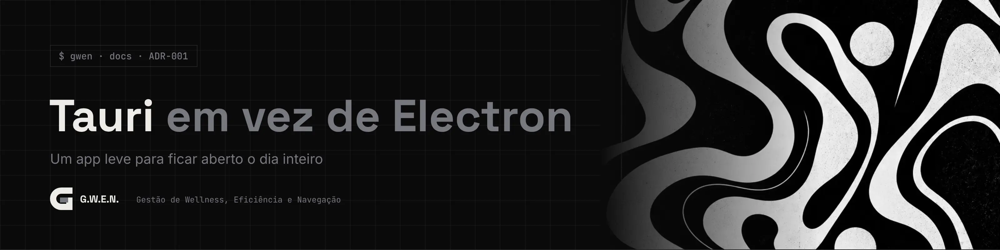

<picture>
  <source media="(prefers-color-scheme: light)" srcset="../../_assets/banners/docs/adr-001-claro.webp">
  
</picture>

# ADR-001 · Tauri em vez de Electron

  

| Campo | Valor |
|---|---|
| Código | `ADR-001` |
| Data | sábado, 17/10/2026 |
| Tipo | Registro de decisão |
| Status | Aceita |
| Decisão de | Samara Silvia |
| Redigido por | Samara Silvia |
| Histórico | [ver alterações](https://github.com/SamaraSilvia81/gwen/commits/main/docs/decisoes/ADR-001-tauri-em-vez-de-electron.md) |

**Sumário**

1. [Contexto](#-contexto)
2. [Decisão](#-decisão)
3. [Alternativas consideradas](#-alternativas-consideradas)
4. [Consequências](#-consequências)
5. [Revisitar quando](#-revisitar-quando)

---

### $ contexto

A G.W.E.N. precisa fazer coisas que um navegador não pode: abrir o VS Code numa pasta, abrir o Explorer e o Git Bash num diretório, escolher pastas pelo seletor do Windows. Isso exige um app desktop.

Ela também fica **aberta o dia inteiro**, rodando em segundo plano enquanto você trabalha em outros programas pesados (VS Code, navegador, Jira). Consumo de memória importa.

A ideia inicial, vinda da conversa de concepção, era Electron + React.

### $ decisão

Usar **Tauri 2** com **React + Vite** na interface.

### $ alternativas consideradas

| Opção | Prós | Contras |
|---|---|---|
| **Electron + React** | Ecossistema enorme, tudo em JavaScript, muitos exemplos | Leva um Chromium inteiro junto. Para um app que fica aberto o dia todo, o consumo de RAM é o oposto do que se quer. Instalador grande |
| **Tauri + Svelte** | Igual ao Sparky Notes, já conhecido | A preferência de interface é React, que é a stack principal de trabalho |
| **Tauri + React** ✔ | Usa o WebView2 do Windows (já instalado), app leve, instalador pequeno. Lado nativo em Rust só onde precisa | Exige Rust e as Build Tools do Visual Studio para compilar. Menos exemplos que o Electron |
| App web (PWA) | Sem instalação | Não abre programas nem pastas locais. Descartado logo de cara |

### $ consequências

- O lado nativo fica mínimo: dois comandos em `src-tauri/src/lib.rs` (`open_folder` e `path_exists`). Links usam o plugin oficial `opener`; o seletor de pasta, o plugin `dialog`.
- As permissões da janela ficam declaradas em `src-tauri/capabilities/default.json`. Não há acesso livre a shell no frontend, só ações fixas.
- A primeira compilação demora alguns minutos (Rust). As seguintes são rápidas.
- A interface roda também no navegador (`yarn dev`), com fallbacks em `src/lib/native.js`, o que agiliza o trabalho de UI.

### $ revisitar quando

- Surgir uma necessidade que só o Electron resolva bem (por exemplo, uma biblioteca nativa sem equivalente em Rust).
- A detecção de janela ativa (roadmap) se mostrar complexa demais em Rust.

---

<picture>
  <source media="(prefers-color-scheme: light)" srcset="../../_assets/banners/docs/rodape-claro.webp">
  
</picture>
