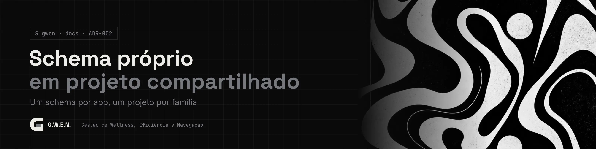

<picture>
  <source media="(prefers-color-scheme: light)" srcset="../../_assets/banners/docs/adr-002-claro.webp">
  
</picture>

# ADR-002 · Schema próprio num projeto Supabase compartilhado

  

| Campo | Valor |
|---|---|
| Código | `ADR-002` |
| Data | sábado, 17/10/2026 |
| Tipo | Registro de decisão |
| Status | Aceita |
| Decisão de | Samara Silvia |
| Redigido por | Samara Silvia |
| Histórico | [ver alterações](https://github.com/SamaraSilvia81/gwen-app/commits/main/docs/decisoes/ADR-002-schema-proprio-em-projeto-compartilhado.md) |

**Sumário**

1. [Contexto](#-contexto)
2. [Decisão](#-decisão)
3. [Alternativas consideradas](#-alternativas-consideradas)
4. [Consequências](#-consequências)
5. [Revisitar quando](#-revisitar-quando)

---

### $ contexto

O plano gratuito do Supabase permite **2 projetos ativos**. Projetos pausados não contam, mas cada app novo precisaria de um projeto próprio, e os dois espaços já estão em uso.

As saídas óbvias eram ruins: criar contas extras com e-mails novos (frágil, cheio de credenciais para gerenciar e com risco de violar os termos do serviço) ou migrar para outro backend (Firebase é NoSQL e obrigaria a repensar tudo que é relacional e protegido por RLS).

### $ decisão

As tabelas da G.W.E.N. ficam num **schema próprio, `gwen`**, dentro do projeto Supabase `apps-tools`, compartilhado com o Sparky Notes (que usa o `public`).

O padrão vale para os próximos apps: **um schema por app, um projeto por família**.

| Projeto | Família | Schemas |
|---|---|---|
| `apps-tools` | aplicativos e ferramentas | `public` (Sparky), `gwen`, próximos |
| `devsam-web` (previsto) | plataformas e sites | um por app |

### $ alternativas consideradas

| Opção | Por que não |
|---|---|
| Projeto novo por app | Esbarra no limite de 2 ativos |
| Contas extras no Supabase | Credenciais espalhadas, risco de perder acesso, não escala |
| Tabelas com prefixo no `public` (`gwen_projects`...) | Funciona, mas mistura tudo no mesmo espaço e polui o Table Editor. Schema separa melhor e permite expor/ocultar por app |
| Firebase | NoSQL, cotas diárias que desligam o produto até o fim do mês, reescrita grande |
| Neon | Postgres com muitos projetos no gratuito, mas sem o pacote do Supabase (Storage, Edge Functions, painel). Fica como opção para quando um app precisar de banco isolado |
| SQLite local | Ideal para desktop, mas perde a sincronização entre máquinas e o login. Fica no roadmap como cache |

### $ consequências

- **Login compartilhado.** A mesma conta serve para todos os apps do projeto. Uma conta criada no Sparky com Google não tem senha, e a G.W.E.N. só tem e-mail e senha na V1.
- **Sem trigger em `auth.users`.** O perfil é criado pelo app no primeiro login, para não afetar os cadastros dos outros apps.
- **Configurações de Auth são do projeto.** Desligar "Confirm email" vale para todos os apps.
- **Passo manual extra:** o schema precisa estar em *Project Settings > Data API > Exposed schemas*. Sem isso a API recusa as chamadas.
- **Espaço dividido:** o limite de banco do projeto é somado entre os apps. Para o volume de apps pessoais, não é problema.
- O schema é configurável (campo Schema da conexão, em Configurações), então a G.W.E.N. pode ir para um projeto próprio sem mudar código.
- ⚠️ Num projeto compartilhado, `supabase db reset` apaga o banco de todos os apps. Migrações devem ser rodadas pelo SQL Editor ou com cuidado no CLI.

### $ revisitar quando

- Algum app crescer a ponto de disputar recursos com os outros.
- Houver plano pago, quando um projeto por app volta a ser simples.

---

<picture>
  <source media="(prefers-color-scheme: light)" srcset="../../_assets/banners/docs/rodape-claro.webp">
  
</picture>
