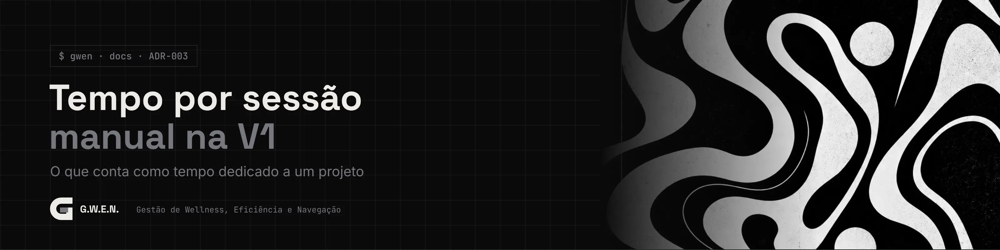

<picture>
  <source media="(prefers-color-scheme: light)" srcset="../../_assets/banners/docs/adr-003-claro.webp">
  
</picture>

# ADR-003 · Tempo por sessão manual na V1

  

| Campo | Valor |
|---|---|
| Código | `ADR-003` |
| Data | sábado, 17/10/2026 |
| Tipo | Registro de decisão |
| Status | Aceita |
| Decisão de | Samara Silvia |
| Redigido por | Samara Silvia |
| Histórico | [ver alterações](https://github.com/SamaraSilvia81/gwen-app/commits/main/docs/decisoes/ADR-003-tempo-por-sessao-manual-na-v1.md) |

**Sumário**

1. [Contexto](#-contexto)
2. [Decisão](#-decisão)
3. [Alternativas consideradas](#-alternativas-consideradas)
4. [Consequências](#-consequências)
5. [Revisitar quando](#-revisitar-quando)

---

### $ contexto

Uma das perguntas que a G.W.E.N. responde é *quanto tempo eu dediquei a cada projeto*. Há duas formas de medir:

- **Sessão manual:** o tempo começa no *Codar agora* e termina no *Encerrar*.
- **Detecção automática:** o app observa qual janela está em foco (VS Code, Jira, YouTube) e soma o tempo em cada uma.

As duas medem coisas diferentes. A sessão responde "quanto tempo dei a este **projeto**". A detecção responde "quanto tempo passei em cada **programa**".

### $ decisão

A V1 mede **só sessões manuais**. A detecção automática fica para uma próxima versão, como um registro independente, sem substituir as sessões.

Para compensar a principal fraqueza da sessão manual (esquecer de encerrar), o app registra um sinal a cada minuto (`last_seen_at`) e, ao abrir, pergunta o que aconteceu se encontrar uma sessão sem sinal há mais de 15 minutos.

### $ alternativas consideradas

| Opção | Por que não na V1 |
|---|---|
| Só detecção automática | Não sabe a qual **projeto** o tempo pertence: o mesmo VS Code serve a vários. Precisaria de heurística por título de janela |
| As duas desde o início | Detecção exige polling em Rust, regras por programa e uma tabela nova. É a parte mais difícil e atrasaria a versão que você usa no dia a dia |
| Timer manual sem detecção de esquecimento | Uma sessão esquecida aberta registraria horas fantasmas e estragaria as estatísticas |

### $ consequências

- O número é **intencional**: reflete o tempo que você declarou estar no projeto, não o tempo real em cada programa.
- O modal de sessão esquecida oferece três saídas (encerrar no último sinal, informar minutos, continuar descontando o tempo fechado). Regras em [`DAT-001`](../DAT-001-modelo-de-dados.md#-regras-de-tempo).
- Pausas são descontadas da sessão; o tempo de pausa fica registrado à parte.
- Só existe uma sessão ativa por vez (garantido por índice único no banco).

### $ revisitar quando

- A versão com detecção de janela chegar. Aí vale decidir se ela sugere automaticamente o projeto (pela pasta aberta no VS Code, por exemplo).

---

<picture>
  <source media="(prefers-color-scheme: light)" srcset="../../_assets/banners/docs/rodape-claro.webp">
  
</picture>
