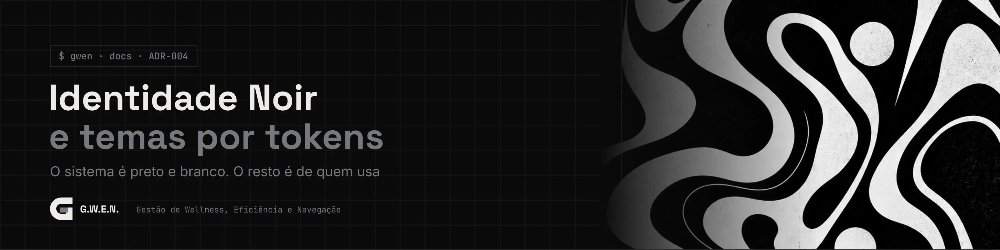

<picture>
  <source media="(prefers-color-scheme: light)" srcset="../../_assets/banners/docs/adr-004-claro.webp">
  
</picture>

# ADR-004 · Identidade Noir e temas por tokens

  

| Campo | Valor |
|---|---|
| Código | `ADR-004` |
| Data | sábado, 17/10/2026 |
| Tipo | Registro de decisão |
| Status | Aceita |
| Decisão de | Samara Silvia |
| Redigido por | Samara Silvia |
| Histórico | [ver alterações](https://github.com/SamaraSilvia81/gwen/commits/main/docs/decisoes/ADR-004-identidade-noir-e-temas-por-tokens.md) |

**Sumário**

1. [Contexto](#-contexto)
2. [Decisão](#-decisão)
3. [Alternativas consideradas](#-alternativas-consideradas)
4. [Consequências](#-consequências)
5. [Revisitar quando](#-revisitar-quando)

---

### $ contexto

A G.W.E.N. vai ser usada por outras pessoas, cada uma com o próprio gosto. Ao mesmo tempo, o sistema precisa de uma cara reconhecível.

A primeira versão misturou as duas coisas: o tema devs_sam (roxo e magenta da identidade pessoal da autora) aparecia como tema do sistema, ao lado do Noir, e o logo usava as cores da devs_sam.

### $ decisão

1. **A identidade do sistema é Noir:** preto, branco e cinzas. Logo, ícone do app, wallpaper, banners do README e o painel do login são Noir.
2. **Qualquer outra identidade é do usuário**, criada no tema **Personalizado**, com nome e exportável em JSON. A identidade devs_sam é um tema de usuário, não do sistema.
3. **Cor e estilo são eixos independentes:** cor (Noir ou Personalizado) e estilo (Moderno ou Terminal) se combinam livremente.
4. **Tudo é token.** As cores são variáveis `--c-*` no `<html>`, com nomes herdados do padrão do portfólio (`--c-void`, `--c-phosphor`, `--c-ember`, `--c-bone`...). Nenhum componente tem cor fixa.

### $ alternativas consideradas

| Opção | Por que não |
|---|---|
| Vários temas prontos no sistema (Noir, devs_sam, outros) | Confunde a identidade do produto com a de quem o fez |
| Só Noir, sem personalização | Tira de quem usa a possibilidade de deixar o app com a própria cara, que foi um requisito desde o início |
| Temas como arquivos CSS separados | Cada tema novo exigiria código. Com tokens, um tema é um objeto de 9 cores |
| Estilo embutido no tema (um "tema terminal" fixo) | Impede combinar, por exemplo, as cores pessoais com o visual de terminal |

### $ consequências

- **Derivados automáticos:** `--c-phosphor-12`, `--c-ember-20`, `--c-void-veil` usam `color-mix`, então qualquer tema funciona sem configuração extra.
- **Contraste automático:** a cor do texto sobre os acentos é escolhida pelo maior contraste (WCAG). O JSON aceita `onPhosphor` e `onEmber` para forçar, como na identidade devs_sam, que usa branco sobre magenta.
- **Logo por tokens:** `--c-logo` e `--c-logo-charge`. No Noir, branco com carga cinza; no Personalizado, acento principal com carga no secundário.
- **Área Noir fixa:** a classe `.noir` mantém a identidade do sistema no painel do login em qualquer tema.
- **Vidro com moderação:** o blur fica só na navegação e no modo pausa. Cards e listas são sólidos, aprendizado do redesign do Summa.sh (estética decorativa atrapalha ferramenta de produtividade).
- **Terminal muda mais que cor:** fonte mono em tudo, raio zero, sem blur, botões como `[ comando ]` e véu do modo pausa opaco (sem blur, um véu translúcido deixa o fundo poluído).
- A marca (nome, logo, wallpaper) fica fora da licença do código. Ver [`NOTICE.md`](../../NOTICE.md).

### $ revisitar quando

- Pedirem modo claro com frequência: um tema claro oficial pode entrar ao lado do Noir, desde que siga a identidade preto e branco.

---

<picture>
  <source media="(prefers-color-scheme: light)" srcset="../../_assets/banners/docs/rodape-claro.webp">
  
</picture>
