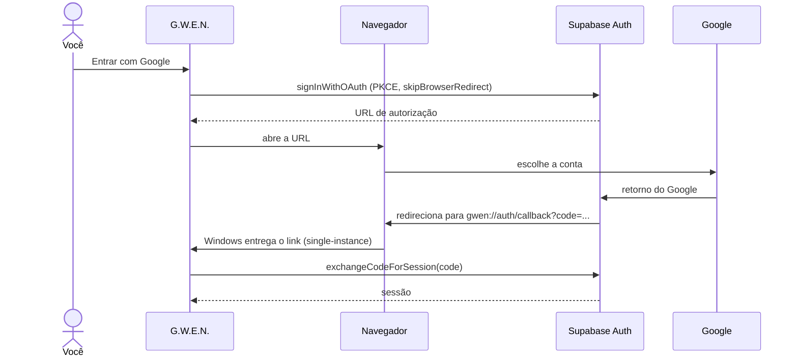

# ADR-006 · Login com Google por deep link

| Código | Status | Data | Decisão de |
|---|---|---|---|
| `ADR-006` | Aceita | 17/10/2026 | Samara Silvia |

### $ contexto

Login com Google num app desktop é diferente da web. Na web, o Google redireciona de volta para a mesma página. Num app Tauri, o Google precisa abrir no **navegador do sistema** (fazer login dentro de uma webview embutida é bloqueado pelo Google e ensina o usuário a digitar senha em janela que não é do navegador), e depois algo precisa **trazer o resultado de volta para o app**.

O projeto Supabase compartilhado (`apps-tools`, ver [`ADR-002`](ADR-002-schema-proprio-em-projeto-compartilhado.md)) já tem o provedor Google configurado por causa do Sparky Notes.

### $ decisão

- Fluxo **OAuth com PKCE** do Supabase.
- No app: o login abre no navegador padrão e volta por **deep link** para `gwen://auth/callback?code=...`. O app troca o código pela sessão com `exchangeCodeForSession`.
- No navegador (`yarn dev`): redirect normal para `http://localhost:1420/`, e o próprio Supabase lê o código da URL.
- Plugins do Tauri: `deep-link` (registra o esquema `gwen://`) e `single-instance` com a feature `deep-link` (entrega o link para a janela que já está aberta, em vez de abrir uma segunda cópia do app).

### $ alternativas consideradas

| Opção | Por que não |
|---|---|
| Login dentro de uma janela do próprio app | O Google bloqueia login em webviews embutidas. Também é pior para segurança |
| Servidor local em `localhost:porta` para receber o retorno | Funciona, mas exige liberar uma porta (ou um padrão de portas) nas Redirect URLs e lidar com porta ocupada. O deep link é o caminho que o Tauri recomenda para desktop |
| Fluxo implícito (token na URL) | PKCE é o padrão atual e não expõe o token na URL |

### $ consequências

- Duas URLs precisam estar em **Authentication > URL Configuration > Redirect URLs** no Supabase: `gwen://auth/callback` e `http://localhost:1420/`.
- No Windows e no Linux o esquema `gwen://` é registrado também em tempo de execução, então o login funciona no `yarn app`, não só no app instalado. Na primeira vez, o navegador pergunta se pode abrir a G.W.E.N.
- O login do Google é compartilhado com o Sparky (mesmo projeto Supabase): a mesma conta entra nos dois.
- O código Rust ganhou o plugin `single-instance`, que precisa ser o **primeiro** a ser registrado.

### $ revisitar quando

- Outros provedores (GitHub, por exemplo) forem pedidos: o fluxo é o mesmo, só muda o `provider`.
