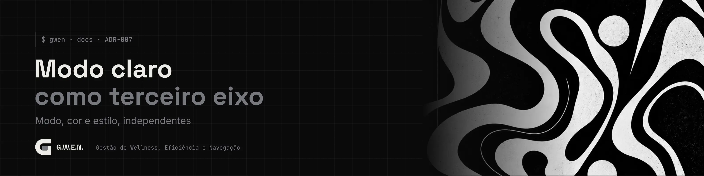

<picture>
  <source media="(prefers-color-scheme: light)" srcset="../../_assets/banners/docs/adr-007-claro.webp">
  
</picture>

# ADR-007 · Modo claro como terceiro eixo da aparência

  

| Campo | Valor |
|---|---|
| Código | `ADR-007` |
| Data | sábado, 17/10/2026 |
| Tipo | Registro de decisão |
| Status | Aceita |
| Decisão de | Samara Silvia |
| Redigido por | Samara Silvia |
| Complementa | [`ADR-004`](ADR-004-identidade-noir-e-temas-por-tokens.md) |
| Histórico | [ver alterações](https://github.com/SamaraSilvia81/gwen-app/commits/main/docs/decisoes/ADR-007-modo-claro-como-terceiro-eixo.md) |

**Sumário**

1. [Contexto](#-contexto)
2. [Decisão](#-decisão)
3. [Alternativas consideradas](#-alternativas-consideradas)
4. [Consequências](#-consequências)

---

### $ contexto

A V0.1 só tinha paletas escuras. O pedido foi ter modo claro e escuro. Pela [`ADR-004`](ADR-004-identidade-noir-e-temas-por-tokens.md), a identidade do sistema é Noir e as cores pessoais vivem no tema Personalizado. Faltava decidir como o claro entra sem quebrar essa regra.

### $ decisão

A aparência passa a ter **três eixos independentes**:

| Eixo | Valores | Onde fica |
|---|---|---|
| Modo | `escuro` · `claro` · `sistema` | `profiles.mode` e `data-mode` no `<html>` |
| Cor | `noir` · `custom` | `profiles.theme` |
| Estilo | `moderno` · `terminal` | `profiles.style` e `data-style` |

- **Noir claro** é oficial: mesma identidade, papel em vez de tinta (fundo `#F4F3F0`, texto e CTA pretos, logo preto com carga cinza).
- **Personalizado** ganha uma paleta clara opcional (`custom_colors.light`). Sem ela, o modo claro usa os **acentos** da paleta escura sobre o papel do Noir claro, o que já funciona bem para quase qualquer identidade.
- **Sistema** segue a preferência do Windows e troca na hora quando ela muda.
- A barra superior tem um botão de alternância rápida entre claro e escuro. A escolha completa (incluindo Sistema) fica nas Configurações, com prévia.
- O painel do login continua escuro, com o wallpaper, nos dois modos: é a cara do sistema.

### $ alternativas consideradas

| Opção | Por que não |
|---|---|
| Inverter as cores automaticamente | Acentos saturados (roxo, magenta) ficam ruins quando invertidos, e o contraste não é garantido |
| Exigir duas paletas completas no Personalizado | Dobra o trabalho de quem só quer trocar os acentos |
| Modo claro só para o Noir | Quem tem identidade própria ficaria preso no escuro |

### $ consequências

- Nova coluna `mode` em `gwen.profiles` (migração `002_gwen_modo_claro.sql`).
- O JSON de tema aceita um bloco `light` com as mesmas chaves.
- O editor do Personalizado tem as abas **Paleta escura** e **Paleta clara**; editar a clara mostra o app claro na prévia.
- `color-scheme` do documento acompanha o modo, então barras de rolagem e controles nativos também mudam.

---

<picture>
  <source media="(prefers-color-scheme: light)" srcset="../../_assets/banners/docs/rodape-claro.webp">
  
</picture>
