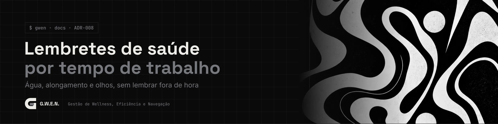

<picture>
  <source media="(prefers-color-scheme: light)" srcset="../../_assets/banners/docs/adr-008-claro.webp">
  
</picture>

# ADR-008 · Lembretes de saúde por tempo de trabalho

  

| Campo | Valor |
|---|---|
| Código | `ADR-008` |
| Data | sábado, 17/10/2026 |
| Tipo | Registro de decisão |
| Status | Aceita |
| Decisão de | Samara Silvia |
| Redigido por | Samara Silvia |
| Histórico | [ver alterações](https://github.com/SamaraSilvia81/gwen-app/commits/main/docs/decisoes/ADR-008-lembretes-por-tempo-de-trabalho.md) |

**Sumário**

1. [Contexto](#-contexto)
2. [Decisão](#-decisão)
3. [Alternativas consideradas](#-alternativas-consideradas)
4. [Consequências](#-consequências)
5. [Revisitar quando](#-revisitar-quando)

---

### $ contexto

O modo saúde é um dos motivos de a G.W.E.N. existir: em dia de foco, é fácil passar horas sem beber água nem levantar. A primeira versão dele traz três lembretes: água, alongamento e descanso dos olhos.

A pergunta é **o que conta como "45 minutos"**. Um timer de relógio comum lembraria de beber água às 3 da manhã com o app aberto e parado, ou logo depois de você voltar de um almoço de uma hora.

### $ decisão

- Os intervalos contam **tempo de trabalho**: só andam com uma sessão ativa (configurável para "app aberto") e **param durante as pausas**.
- Tempo com o app fechado ou com o PC dormindo não conta: cada passo do relógio é limitado a 60 segundos.
- Uma pausa real também é cuidado: pausa de 20 segundos ou mais zera o lembrete dos olhos; de 5 minutos ou mais (ou de alongamento), zera o de alongamento.
- O lembrete vencido **fica na tela até você responder**: fazer, adiar 10 minutos ou dispensar. Nada some sozinho.
- Notificação do Windows só quando a G.W.E.N. não está em primeiro plano. Com ela na frente, o cartão dentro do app basta.
- **Alongar agora** abre uma pausa guiada de 5 minutos, um movimento por minuto, com o aviso "sem forçar, se doer, pare".
- O modo saúde vem **desligado**. Ligar é escolha de quem usa.
- Cada resposta vira um evento (`gwen.wellness_events`: tipo, ação, sessão). É a base para, no futuro, a pessoa ver os próprios hábitos.

### $ alternativas consideradas

| Opção | Por que não |
|---|---|
| Timer de relógio (a cada X minutos, sempre) | Lembra fora de hora e ignora as pausas que a pessoa já fez |
| Só notificação do sistema | Some na central de notificações e é fácil de ignorar. Com o app na frente, o cartão interno é mais claro |
| Lembrete que fecha sozinho depois de um tempo | Ignorar viraria hábito sem ninguém perceber. Responder, mesmo dispensando, é um registro honesto |
| Ligado por padrão | Interromper quem não pediu vai contra a ideia de respeitar o ritmo de cada um |

### $ consequências

- Contadores ficam no `localStorage` (por máquina) e sobrevivem a fechar o app. As respostas ficam no banco.
- Configuração em `profiles.wellness` (JSON), com padrões em `src/lib/wellness.js`. Campos novos aparecem sozinhos para quem já tinha configuração salva.
- Plugin `notification` do Tauri adicionado, com permissão `notification:default`.
- Migração `003_gwen_wellness.sql`: coluna `wellness`, tabela `wellness_events` e o tipo de pausa `alongamento`.
- Os textos evitam tom clínico. Não é recomendação médica; é um empurrão gentil.

### $ revisitar quando

- O mapeamento de comportamento (foco, programas abertos, áudio) chegar: aí os lembretes podem considerar, por exemplo, se a pessoa está há muito tempo no mesmo programa.
- Pedirem lembretes personalizados (remédio, postura): a estrutura de `REMINDERS` já comporta.

---

<picture>
  <source media="(prefers-color-scheme: light)" srcset="../../_assets/banners/docs/rodape-claro.webp">
  
</picture>
