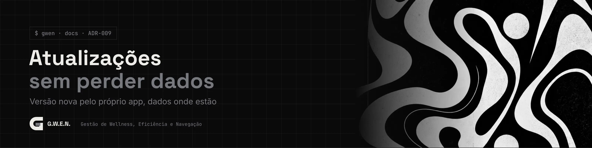
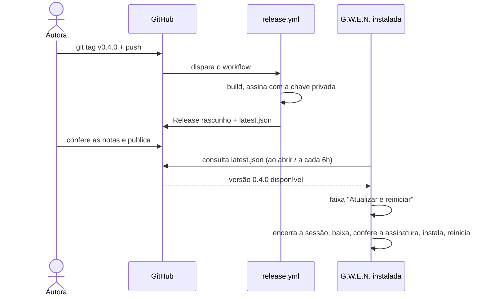

<picture>
  <source media="(prefers-color-scheme: light)" srcset="../../_assets/banners/docs/adr-009-claro.webp">
  
</picture>

# ADR-009 · Atualizações sem perder dados

  

| Campo | Valor |
|---|---|
| Código | `ADR-009` |
| Data | sábado, 17/10/2026 |
| Tipo | Registro de decisão |
| Status | Aceita |
| Decisão de | Samara Silvia |
| Redigido por | Samara Silvia |
| Histórico | [ver alterações](https://github.com/SamaraSilvia81/gwen-app/commits/main/docs/decisoes/ADR-009-atualizacoes-sem-perder-dados.md) |

**Sumário**

1. [Contexto](#-contexto)
2. [Decisão](#-decisão)
3. [Alternativas consideradas](#-alternativas-consideradas)
4. [Consequências](#-consequências)
5. [Revisitar quando](#-revisitar-quando)

---

### $ contexto

A G.W.E.N. vai ser instalada por outras pessoas, primeiro um grupo de amigos e depois o público. Cada versão nova precisa chegar até elas sem obrigar a desinstalar, procurar o instalador ou correr o risco de perder projetos, tempos e configurações.

Hoje os dados ficam em dois lugares:

| Dado | Onde fica | Afetado por atualizar? |
|---|---|---|
| Projetos, sessões, pausas, perfil, eventos do modo saúde | Supabase (schema `gwen`) | Não. Está na nuvem |
| Sessão de login, aparência, contadores do modo saúde | Armazenamento local da webview, em `%LOCALAPPDATA%\sh.devs-sam.gwen\` | Não. Fica fora da pasta do programa |
| O programa | pasta de instalação escolhida no instalador | Sim. É o que a atualização troca |

Com o local-first (versão 0.4), os dados principais passam para um banco SQLite na pasta de dados do usuário, e a regra abaixo passa a ser ainda mais importante.

### $ decisão

**1. Atualização pelo próprio app.**
Plugins `updater` e `process` do Tauri. Ao abrir (e a cada 6 horas), a G.W.E.N. consulta o `latest.json` da Release mais recente no GitHub. Se houver versão nova, mostra uma faixa com "Atualizar e reiniciar". Nada é instalado sem clique. Antes de reiniciar, a sessão ativa é encerrada, para o tempo não virar sessão esquecida.

**2. Instalador assinado.**
Cada versão é assinada com uma chave privada da autora. O app só instala o que bate com a chave pública gravada em `tauri.conf.json`. Isso impede que alguém publique uma "atualização" falsa.

**3. Dados fora do programa, sempre.**
Programa e dados ficam em pastas separadas. A atualização troca só o programa. Desinstalar também não apaga os dados.

**4. O identificador do app nunca muda.**
`sh.devs-sam.gwen` é o que liga o app à pasta de dados. Mudar esse valor faz a versão nova "esquecer" tudo, como se fosse outro programa.

**5. Mudanças de banco só para a frente.**
Migrações numeradas (`001`, `002`, `003`...), que só acrescentam: colunas novas com valor padrão, tabelas novas, tipos novos. Nunca apagam nem renomeiam coluna em uso numa versão menor. No banco local da 0.4, a versão do esquema fica gravada no próprio arquivo, o app aplica as migrações pendentes ao abrir e faz uma cópia do banco antes de cada migração.

**6. Versões em SemVer.**
`0.x` enquanto for beta. A tag `vX.Y.Z` no GitHub dispara o workflow `release.yml`, que gera o instalador, assina e cria a Release como rascunho, com o `latest.json`.

### $ alternativas consideradas

| Opção | Por que não |
|---|---|
| Sem atualizador, só "baixe a versão nova" no site | Quase ninguém atualiza assim. Versões velhas ficariam em uso por meses |
| Atualizar sozinho em segundo plano, sem perguntar | Reiniciar no meio de uma sessão de foco é exatamente o tipo de interrupção que a G.W.E.N. quer evitar |
| Servidor de atualização próprio | GitHub Releases já entrega o arquivo de graça e com histórico |
| Pré-release no GitHub para as versões beta | O endereço `/releases/latest` ignora pré-releases, e o atualizador não encontraria a versão |

### $ consequências

- ⚠️ **A chave privada não pode ser perdida.** Sem ela, não dá para assinar versões novas, e quem já instalou só recebe atualização reinstalando manualmente. Guarde o arquivo `.key` e a senha num gerenciador de senhas e fora do repositório.
- O primeiro instalador com o atualizador precisa ser distribuído manualmente. Daí em diante, as versões chegam pelo app.
- O workflow precisa dos segredos de assinatura e das variáveis do Supabase, porque elas entram no app no momento do build.
- Os arquivos assinados de atualização só são gerados no CI (`tauri.updater.conf.json`). O `yarn app:build` local continua funcionando sem a chave, mas o instalador gerado assim não serve como atualização.
- As notas da Release aparecem no botão "Novidades" da faixa de atualização.

### $ revisitar quando

- A G.W.E.N. ganhar versão para macOS ou Linux: o workflow precisa de um job por sistema.
- Houver canal beta separado (por exemplo, amigos testando antes do público): um segundo `latest.json` em outro endpoint resolve.

---

<picture>
  <source media="(prefers-color-scheme: light)" srcset="../../_assets/banners/docs/rodape-claro.webp">
  
</picture>
