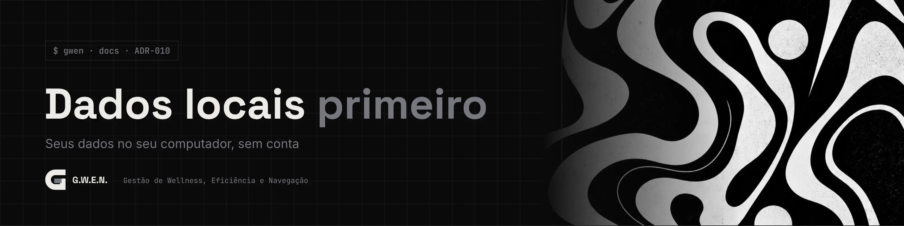
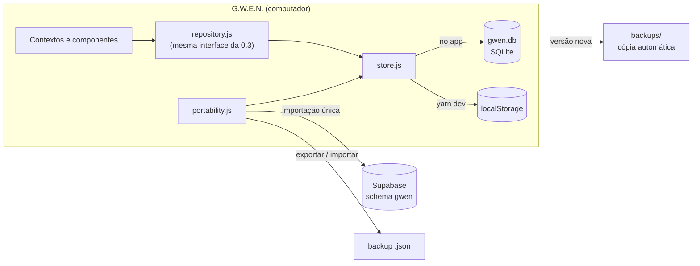

<picture>
  <source media="(prefers-color-scheme: light)" srcset="../../_assets/banners/docs/adr-010-claro.webp">
  
</picture>

# ADR-010 · Dados locais primeiro

  

| Campo | Valor |
|---|---|
| Código | `ADR-010` |
| Data | sábado, 17/10/2026 |
| Tipo | Registro de decisão |
| Status | Aceita |
| Decisão de | Samara Silvia |
| Redigido por | Samara Silvia |
| Referências | [`ADR-002`](ADR-002-schema-proprio-em-projeto-compartilhado.md), [`ADR-006`](ADR-006-login-google-por-deep-link.md), [`ADR-009`](ADR-009-atualizacoes-sem-perder-dados.md) |
| Histórico | [ver alterações](https://github.com/SamaraSilvia81/gwen-app/commits/main/docs/decisoes/ADR-010-dados-locais-primeiro.md) |

**Sumário**

1. [Contexto](#-contexto)
2. [Decisão](#-decisão)
3. [Alternativas consideradas](#-alternativas-consideradas)
4. [Consequências](#-consequências)
5. [Revisitar quando](#-revisitar-quando)

---

### $ contexto

Até a 0.3, a G.W.E.N. gravava tudo no Supabase, com login obrigatório. Isso funcionava para uso pessoal, mas travava a distribuição: um instalador público levaria a URL e a chave do projeto da autora, e todas as contas e dados de outras pessoas iriam para o Supabase dela, com o limite do plano gratuito, o custo e a responsabilidade pelos dados de terceiros.

A G.W.E.N. é um produto gratuito no modelo do Obsidian: o app é de quem instala, e os dados também.

### $ decisão

- **Os dados ficam no computador**, num banco SQLite (`gwen.db`) na pasta de dados do app, gerenciado pelo plugin `sql` do Tauri.
- **Sem login.** A primeira abertura pede só o nome. O perfil (nome, aparência, modo saúde) também é local.
- **Nuvem opcional e depois.** A sincronização entre computadores fica para uma versão seguinte. O Supabase continua no projeto só para a **importação única** de quem usou as versões até a 0.3.
- **Importação da nuvem, uma vez.** Entra na conta antiga (Google ou e-mail), copia categorias, projetos, sessões, pausas, eventos do modo saúde e aparência, e sai da conta. Só entra o que ainda não existe aqui (mesmo id). Nada é apagado, nem aqui nem na nuvem.
- **Backup na mão da pessoa.** Exportar e importar um JSON completo em Configurações > Dados, mais o botão para abrir a pasta de dados.
- **Cópia automática a cada versão.** Ao abrir uma versão nova, antes de o banco rodar as migrações, o app copia o `gwen.db` para `backups/` (guarda as 5 mais recentes). Ver [`ADR-009`](ADR-009-atualizacoes-sem-perder-dados.md).
- **A interface dos repositórios não mudou.** `data/repository.js` mantém os mesmos métodos; por baixo, um `store` com cinco operações (`all`, `insert`, `update`, `remove`, `meta`). No navegador (`yarn dev`), o mesmo `store` usa `localStorage`.

### $ alternativas consideradas

| Opção | Por que não |
|---|---|
| Continuar no Supabase da autora para todo mundo | Custo, limite, dados de terceiros sob responsabilidade dela. Inviável para um produto gratuito |
| Cada pessoa configurar o próprio Supabase | Funciona para dev, mas é uma barreira enorme para todo o resto. Fica como opção avançada da sincronização |
| IndexedDB dentro da webview | Os dados ficariam presos ao armazenamento do navegador embutido, difíceis de achar, copiar ou fazer backup. Um arquivo `.db` é transparente |
| Sincronização já nesta versão | Dobraria o tamanho da versão e traria conflitos de edição para resolver. Primeiro o local precisa estar sólido |

### $ consequências

- **Distribuição destravada:** o instalador não precisa de `.env`. Sem a conexão do Supabase (colada em Configurações), a importação da nuvem simplesmente não aparece.
- **Dados de uma pessoa cabem em memória:** filtros e ordenações ficam em JavaScript. Integridade que antes era do banco (uma sessão ativa por vez, apagar sessões junto com o projeto, categoria apagada vira "Sem categoria") agora fica no repositório.
- **Sem RLS:** não há mais várias pessoas no mesmo banco. A proteção é a do próprio sistema operacional sobre a pasta do usuário.
- **Migrações do banco local** ficam em `src-tauri/migrations/` e são registradas no Rust. As do Supabase (`supabase/migrations/`) continuam valendo para a importação e para a futura sincronização.
- O [`ADR-002`](ADR-002-schema-proprio-em-projeto-compartilhado.md) (schema próprio no Supabase) e o [`ADR-006`](ADR-006-login-google-por-deep-link.md) (login com Google por deep link) continuam válidos, agora só para a nuvem.
- O `localStorage` deixa de guardar dados e fica só com conveniências: aparência antes do banco abrir e contadores do modo saúde.

### $ revisitar quando

- A sincronização entrar: aí é preciso decidir o modelo de conflito (última escrita vence por registro é o mais simples) e se a nuvem é da autora (assinatura) ou da pessoa (Supabase próprio).
- Os dados de alguém crescerem a ponto de carregar tudo em memória pesar: os filtros descem para SQL, sem mudar a interface do repositório.

---

<picture>
  <source media="(prefers-color-scheme: light)" srcset="../../_assets/banners/docs/rodape-claro.webp">
  
</picture>
