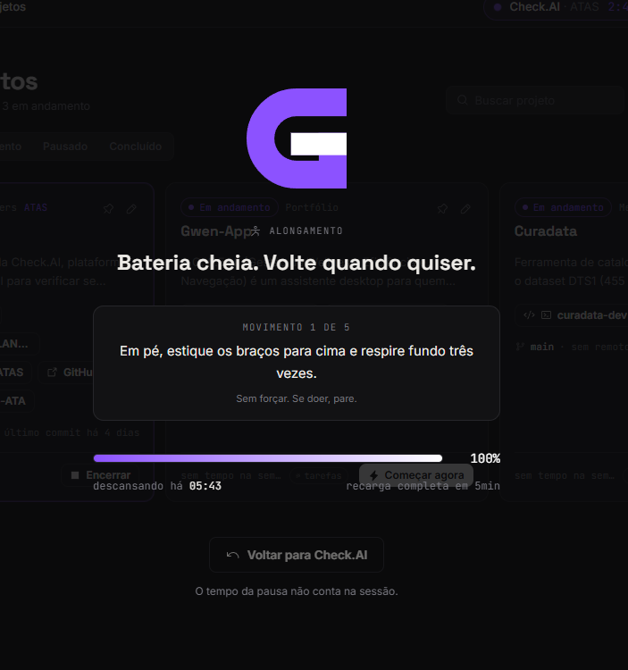
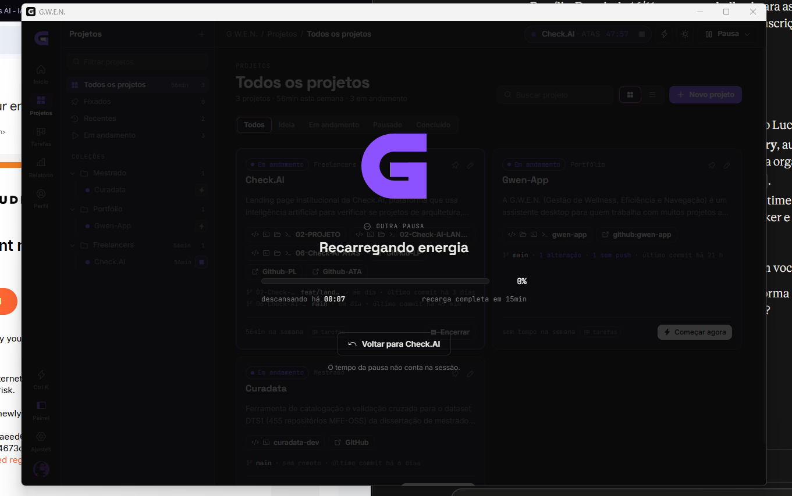
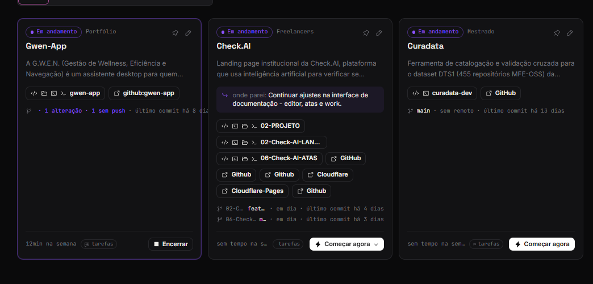
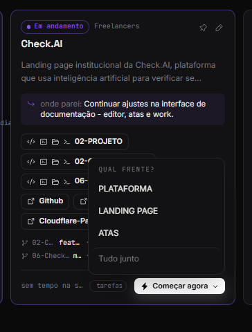

<picture>
  <source media="(prefers-color-scheme: light)" srcset="../_assets/banners/docs/fbk-001-claro.png">
  
</picture>

# FBK-001 · Feedback de uso — beta 0.9

  

| Campo | Valor |
|---|---|
| Código | `FBK-001` |
| Data | segunda-feira, 26/10/2026 |
| Tipo | Feedback |
| Status | Processado |
| Versão testada | 0.9.0 |
| Período de uso | aproximadamente uma semana |
| Relatado por | Samara Silvia |
| Redigido por | Samara Silvia |
| Referências | [`ADR-013`](../decisoes/ADR-013-sessoes-em-paralelo-e-mapeamento-local.md) · [`ADR-014`](../decisoes/ADR-014-tarefas-locais-e-issues-somente-leitura.md) · [`ADR-008`](../decisoes/ADR-008-lembretes-por-tempo-de-trabalho.md) |
| Histórico | [ver alterações](https://github.com/SamaraSilvia81/gwen-app/commits/main/docs/feedbacks/FBK-001-feedback-uso-beta-0.9.md) |

**Sumário**

1. [Contexto](#-contexto)
2. [Bugs encontrados](#-bugs-encontrados)
3. [Melhorias de interface](#-melhorias-de-interface)
4. [Funcionalidades desejadas](#-funcionalidades-desejadas)
5. [Opiniões e reflexões](#-opiniões-e-reflexões)
6. [O que foi resolvido](#-o-que-foi-resolvido)

---

### $ contexto

Feedback de uso real da própria autora após aproximadamente uma semana usando a G.W.E.N. 0.9.0 como ferramenta principal de trabalho. Os projetos ativos no período foram Check.AI (três frentes: Plataforma, Landing Page e ATAS), Gwen-App e Curadata.

---

### $ bugs encontrados

**Travamento no modo alongamento**

Ao confirmar o alongamento no lembrete de saúde, a G.W.E.N. abre a tela de pausa guiada. Ao tentar encerrar a pausa pelo botão "Voltar", o app travava: o botão ficava desabilitado, a tela não saia e o app não respondia nem ao fechar a janela nem ao reiniciar o computador. Foi necessário encerrar o processo pelo Gerenciador de Tarefas. O problema durou cerca de 10 a 15 minutos antes de ser percebido.

Causa identificada: `endBreak` faz operações sequenciais no SQLite sem timeout. Se qualquer chamada ao banco travar, o `leaving` fica `true` e o overlay de `z-[150]` bloqueia toda a interface, inclusive os controles nativos do Tauri.

  
   Tela de pausa de alongamento com a barra em 100% e o botão não respondendo

**Tela de pausa sem blur**

O fundo da tela de pausa aparecia escuro mas sem o efeito de desfoque esperado. O efeito correto pode ser visto no print `fbk-001-pausa-blur-esperado.png`: o conteúdo da tela anterior fica visível e borrado por trás do overlay.

Causa identificada: o overlay usa `background: var(--c-pause-veil)` direto, sem `backdrop-filter`. A classe `.glass`, que tem o blur, não era aplicada porque usa `--c-surface-glass` como fundo, diferente do token de pausa.

  <table>
  <tr>
  <td> Esperado: blur visível no fundo</td>
  <td> Encontrado: fundo só escuro, sem blur</td>
  </tr>
  </table>

**Mapeamento de apps: YouTube e redes sociais não registrados**

O YouTube e outras redes sociais abertas no navegador não apareciam no mapeamento de apps nem em nenhuma categoria. O sistema rastreia por executável (`chrome.exe`, `brave.exe`), não por site, então tudo do navegador cai como "Navegador". O YouTube instalado como PWA também não era reconhecido separadamente.

Situação: o YouTube PWA foi instalado como app e passa a aparecer como processo próprio no Windows. A categorização como "Mídia" ainda depende de mapeamento explícito do executável gerado pelo PWA.

**Apps de Steam e outros launchers**

`steam.exe` e `epicgameslauncher.exe` estão na lista de jogos, mas o tempo dos jogos lançados por eles não era registrado corretamente. O mapeamento está desligado por padrão (ADR-013), o que pode ser a causa principal.

---

### $ melhorias de interface

**Saudação cortando o nome**

A saudação no Início mostrava apenas `~/` em vez de `~/ sammy.sh`. O `display_name` era dividido em `split(' ')[0]`, pegando só o trecho antes do primeiro espaço.

  
   Saudação exibindo apenas o início do nome

**Informações de commit saindo do card**

Na vista em grade, o texto "último commit há X dias" ultrapassava a borda do card quando havia mais informações na linha do Git (branch, alterações, commits sem push).

  
   Linha do Git ultrapassando o card em alguns projetos

---

### $ funcionalidades desejadas

**Abrir múltiplas frentes do mesmo projeto ao mesmo tempo**

Com sessões em paralelo (0.8), é possível ter mais de um projeto rodando. Mas dentro do mesmo projeto, com várias frentes cadastradas, só era possível abrir uma por vez. A necessidade surgiu no Check.AI: Plataforma, Landing Page e ATAS precisavam estar abertas ao mesmo tempo.

  
   Seletor de frente atual — só permite escolher uma por Começar agora

**Documentação no sistema (módulo Caderno)**

Desejo de ter a documentação do projeto dentro da G.W.E.N., no formato já adotado (ADRs, ARQ, DAT). Previsto para 0.12 no roadmap.

**Relatório mais completo**

Filtros por período personalizado, comparativo entre projetos e entre categorias. O relatório atual cobre semana, mês, mês passado e 30 dias, com exportação em CSV.

**Hábitos com página própria**

A grade de hábitos no Perfil foi considerada útil, mas o desejo é ter uma página separada com drill-down por dia: clicar num quadrado do heatmap e ver o detalhe daquele dia, comparativo entre semanas e filtro por tipo de hábito.

**Tarefas com GitHub Projects**

Além das Issues somente leitura (ADR-014), o desejo é ter conexão bidirecional com GitHub Projects v2 (GraphQL). Fechar uma tarefa na G.W.E.N. moveria o card no Project, e criar uma tarefa na G.W.E.N. criaria uma Issue.

**Alertas inteligentes e newsletter**

Desejo de receber alertas sobre assuntos de interesse (preço de produto, notícias do mestrado, bolsa, dólar) e sugestões de leitura (livros, artigos, papers) por área. Pode funcionar como módulo no app e/ou como newsletter por e-mail. O Farol do Summa Academic e o Sparky Notes têm partes aproveitáveis para isso.

**Versão mobile**

Desejo de ter a G.W.E.N. no celular após a 1.0. O Tauri tem suporte a mobile, mas a UX precisaria ser repensada para o formato.

**Expansão de escopo com onboarding por ambiente**

A G.W.E.N. hoje é focada em TI. O desejo é expandir para outros perfis (Acadêmico, Design, Geral) com terminologia e recursos adaptados: status de projeto diferentes, integrações específicas por ambiente e seleção no onboarding. O núcleo (sessões, tempo, tarefas, pausa) seria o mesmo para todos.

**Extensão de hábitos**

Ver cada hábito em detalhe a partir do Perfil, com histórico e sequência, como uma página separada.

---

### $ opiniões e reflexões

**Experiência geral**

O sistema é fácil e agradável de usar. A proposta de abrir o projeto e começar a sessão com um clique funciona bem no dia a dia. O modo pausa foi usado ativamente, e o registro de "onde parei" se mostrou útil para retomar projetos.

**Identidade e produto**

A identidade Noir é o centro do sistema. O roxo e rosa são a cor pessoal da autora, não parte da identidade do produto. O plano é um beta fechado com amigos antes do lançamento público como produto gratuito.

**Roadmap confirmado pela autora**

| Versão | Tema |
|---|---|
| 0.10 | Calendário com Google Calendar |
| 0.11 | Finanças: projetos comercializados e valor da hora |
| 0.12 | Caderno: playbook, modelos e editor de documentação |
| 0.13 | Ideias (módulo Sparky): captura e refino com IA local |
| 0.14 | Padrões de trabalho: ritmo, foco e histórico do Git |
| 1.0 | Assistente local que conversa sobre os dados e revisa o trabalho |

**Desejos sem versão definida**

E-mail dentro do app, terminal próprio, TrackFox como módulo, voz e recomendações por área, personalização de fontes e landing page pública.

---

### $ o que foi resolvido

Os itens abaixo foram corrigidos ainda na 0.9, em patches aplicados após este feedback.

| Item | Commit |
|---|---|
| Travamento no alongamento | `fix: prevent stretch overlay from locking the ui on slow db calls` |
| Blur da tela de pausa | `fix: add backdrop blur to pause overlay` |
| Saudação cortando o nome | `fix: show full display name in home greeting instead of first word only` |
| Commit saindo do card | `fix: clip git status line inside project card bounds` |
| Abrir múltiplas frentes ao mesmo tempo | `feat: allow launching additional fronts on an already active project` |

---

<picture>
  <source media="(prefers-color-scheme: light)" srcset="../../_assets/banners/docs/rodape-claro.webp">
  
</picture>
